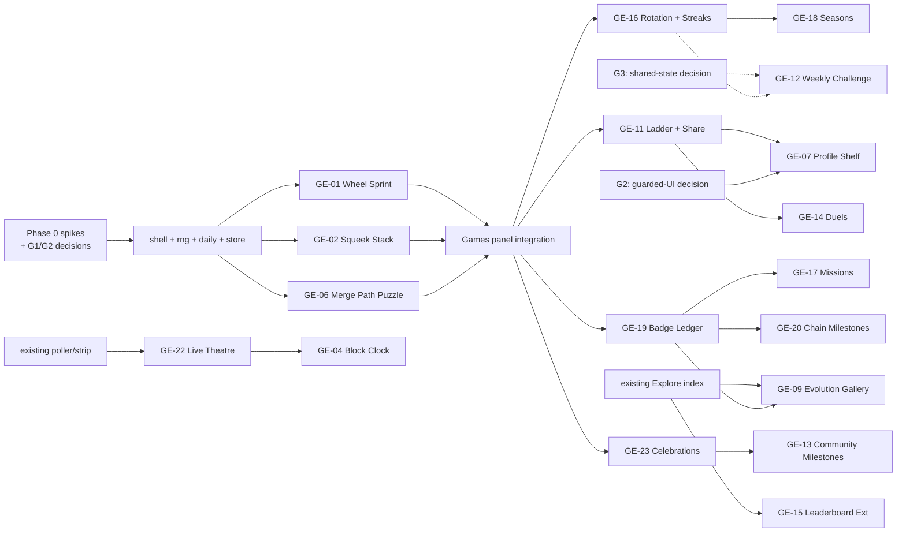

# Wheelhouse Build Plan — Games and Engagement

**Status:** planning artefact. No code, contract, dependency, configuration or existing document is
changed by this plan. Approval to build is a separate decision.

**Companion document:** [GAMES_AND_ENGAGEMENT.md](GAMES_AND_ENGAGEMENT.md) — capability audit,
idea catalog, feature evaluations, weighted ranking, trust models, open questions.

**Feature vocabulary:** every feature is referenced here by its stable ID from the engagement
document (`GE-01` … `GE-24`). No phase in this plan introduces a feature that is not scored there.
Audited revision: `9557475`. All capability claims carry the IDs `C01`–`C30` from

## Contents

1. [Goals and non-goals](#1-goals-and-non-goals)
2. [Architecture principles](#2-architecture-principles)
3. [Phase 0 — Foundations](#3-phase-0--foundations-and-research)
4. [Phase 1 — The Game MVP](#4-phase-1--quick-wins--the-game-mvp)
5. [Phases 2–4](#5-phases-24)
6. [Feature-to-phase mapping](#6-feature-to-phase-mapping)
7. [Technical implementation strategy](#7-technical-implementation-strategy)
8. [Infrastructure decision gates](#8-infrastructure-decision-gates)
9. [Security checkpoints](#9-security-checkpoints)
10. [Metrics and validation](#10-metrics-and-validation)
11. [MVP execution sequence](#11-mvp-execution-sequence)
12. [Dependencies, critical path and risks](#12-dependencies-critical-path-and-risks)
13. [Validation checklist](#13-final-validation-checklist-for-the-planning-pair)

---
[§3.2 of the engagement document](GAMES_AND_ENGAGEMENT.md#32-capability-matrix).

---

## 1. Goals and non-goals

### 1.1 Goals

| # | Goal | How it will be judged |
| --- | --- | --- |
| G1 | Give first-time visitors something to *do* in under 10 seconds, with no wallet | A visitor can complete a full game run without connecting or reading the chain |
| G2 | Teach the real merge mechanics through play, not copy | A player who finishes `GE-06` can state why two Squeeks must be the same level and why the donor is burned |
| G3 | Increase repeat visits without a backend | Day-seeded variation plus personal best plus one open puzzle per target level |
| G4 | Preserve every existing security guarantee | Zero new signatures, zero new transactions, zero new origins, zero new dependencies; all existing tests pass unchanged |
| G5 | Stay inside the static deployment envelope | Build stays under the 500,000-byte gzip cap; no service worker; no backend |
| G6 | Make every claim honest | Local scores labelled local; chain facts labelled chain; `Unavailable` never rendered as `0` |

### 1.2 Non-goals (explicit)

- No new smart contracts, no token, no reward, no airdrop, no allowlist, no NFT metadata change.
- No backend, database, authentication, indexer, serverless function, queue or cron.
- No analytics SDK, no third-party scripts, no new `connect-src` origin.
- No global, shared or "verified" leaderboard (see gate **G3**).
- No gambling-like mechanic: no wager, no loot box, no chance-based value, no "spin to win".
- No pay-to-win: holding a Squeek changes *content*, never *scoring*.
- No transaction for the purpose of recording play; no signature for profiles or scores.
- No third-party game engine or physics library; no WebGL requirement.
- No change to `docs/DESIGN.md`, `docs/SECURITY.md`, `docs/STATUS.md`, `docs/CHANGELOG.md`,
  the pins under `sdk/`, or `web/_headers`.

---

## 2. Architecture principles

Derived from the audit (`C01`–`C30`) and from `docs/DESIGN.md` / `docs/SECURITY.md`. Each principle
has a testable consequence, because a principle without a test is a slogan.

| Principle | Testable consequence |
| --- | --- |
| **P1 — Games are inert with respect to value.** No game module imports a signing path, a prepare/request tool, `web/activity.js` write helpers, or any code that builds calldata. | A static import-graph assertion fails if any `web/games/**` file imports `web/wallet.js` provider methods, `sdk/tool-runtime.js` prepare paths, or `web/activity.js`. |
| **P2 — Verified reads are reused, never re-implemented.** Games read through existing adapters/components. | No `client.readContract`/`getLogs`/`fetch` call inside `web/games/**`; the only permitted chain entry is a passed-in snapshot or an existing component. |
| **P3 — Local means local, and says so.** Every score surface carries the disclaimer string. | A copy test asserts the disclaimer renders on each score surface. |
| **P4 — Lazy and small.** Each game is a separate dynamic import; the build's gzip budget is asserted. | `dist/js-size.json` total stays below the cap and each `games/*` chunk is under a stated ceiling (start: 20 KB gzip). |
| **P5 — Baseline surfaces are frozen.** `web/components.js` and the `web/styles.css` prefix stay byte-identical. | `npm test` (which includes `test/frontend-baseline.mjs`) passes with **no fixture change**. |
| **P6 — Honest states.** Missing data renders as `—` plus explanation; never `0`, and never the literal word "Unknown" in a rendered tab (that is asserted by `test/visual-qa.spec.mjs`). | A no-network Playwright run asserts the games panel is playable and free of fabricated zeros. |
| **P7 — Accessible by default.** Keyboard parity, reduced-motion variant, 44 px targets, 390 px layout. | Keyboard-only spec completes one full run of each game; reduced-motion spec asserts no `requestAnimationFrame`-driven motion requirement. |
| **P8 — Pure logic, impure edges.** Game rules are pure functions; canvas/storage/DOM live at the boundary. | Reducer/referee unit tests run in Node with no DOM. |
| **P9 — Persistence is a claim, not a ledger.** Versioned schema, validated on read, discardable, never authority. | Corrupt/forward-version storage fixtures are discarded without throwing. |
| **P10 — Nothing ships that needs a decision nobody made.** Ambiguity routes to a gate (§8), not to a guess. | Every unresolved item appears in the gates table with an explicit default. |

---

## 3. Phase 0 — Foundations and research

**Duration:** 3–4 dev-days. **Risk:** low.

### 3.1 Goals

Confirm the audit's assumptions with small spikes; agree the integration points; freeze the
conventions that later phases depend on.

### 3.2 Scope

| Item | Detail |
| --- | --- |
| P0.1 | Confirm `C01`–`C30` by re-running the audit against the merge base of the implementation branch; record any drift. |
| P0.2 | **Spike A (≤0.5 day):** prove a lazy module can be added to `build.mjs`'s explicit file list, imported from `web/app.js` by `import()`, and pass `test/dist-imports.mjs`. |
| P0.3 | **Spike B (≤0.5 day):** measure a trivial canvas module's gzip cost and confirm the total stays well under the cap. |
| P0.4 | **Spike C (≤0.5 day):** confirm the Games entry point decision (gate **G1**): sixth tab vs. section inside an existing panel, given `test/frontend-baseline.mjs` guards tab markup. |
| P0.5 | Define the local-store schema (`wheelhouse:games:v1`) and its validation rules. |
| P0.6 | Define the shared shell contract: `mount(root, {seed, store, reducedMotion, onExit})`, input adapter, score announcement, pause on `visibilitychange`. |
| P0.7 | Write the security and testing checklist (copy of §9 + §11) into the first implementation PR's description, not into `docs/` (tests may not write there; `test/docs-write-guard.mjs`). |
| P0.8 | Confirm with the owner whether game data must be cleared by the existing "Clear saved data" button (open question Q9). |

### 3.3 Prerequisites

- Nothing. Phase 0 must be completable without touching tracked source; spikes live in a scratch
  branch or `/tmp` and are not merged.

### 3.4 Acceptance criteria

- [ ] Drift report exists for `C01`–`C30`; any change is reflected in the engagement document.
- [ ] Spikes A–C produce measured numbers (bytes, import resolution, bundle total) recorded in the PR.
- [ ] Store schema and shell contract are written down and reviewed.
- [ ] **G1** (entry point) and **G2** (styling/baseline ownership, open question Q2) are decided.
- [ ] No tracked file changed by Phase 0 itself.

### 3.5 Effort

**S–M** (3–4 days). Spike C's outcome can move the estimate ±2 days — **flagged high uncertainty**,
because the decision is organisational, not technical.

---

## 4. Phase 1 — Quick wins / the Game MVP

**Duration:** ~15–20 dev-days (≈3–4 weeks). **Risk:** medium, concentrated in `GE-06`'s copy and in
the entry-point integration.

**Scope is capped by design:** `GE-01` + `GE-02` + `GE-06`, plus the shared primitives they need.
Nothing else may enter this phase; anything else is Phase 2+.

### 4.1 Goals

Ship a playable, wallet-optional arcade with one mechanic-teaching puzzle, inside the existing static
deployment, without a new infrastructure decision.

### 4.2 Exact feature scope

| ID | Feature | Tier | Notes |
| --- | --- | --- | --- |
| GE-01 | Daily Wheel Sprint | A | Day-seeded; personal best; local-only |
| GE-02 | Squeek Stack | A | Level ladder labelled from `SQUEEKS_POLICY`/`net.policy.levels` |
| GE-06 | Merge Path Puzzle | A/B | Seeded synthetic collection; optional "play my Squeeks"; referee = `planToLevel`/`browseState` |

Shared, non-feature modules: `games/shell.js`, `games/rng.js`, `games/daily.js`,
`games/store.js`, `games-panel.js`.

### 4.3 Prerequisites

Phase 0 complete; **G1** decided; **G2** decided (at minimum: "new files only, no styling hooks into
guarded markup" — which is sufficient for this phase, since none of the three features restyles an
existing card).

### 4.4 Proposed modules and components

| Path | Purpose | Est. gzip |
| --- | --- | --- |
| `web/games-panel.js` | Panel content, tile list, disclaimer, lazy game loading, address scope | ~4 KB |
| `web/games/shell.js` | Loop, input, canvas sizing, a11y announcements, reduced-motion, exit | ~5 KB |
| `web/games/rng.js` | Deterministic PRNG + seed derivation from UTC date | ~1 KB |
| `web/games/daily.js` | Day key, rotation selection | ~1 KB |
| `web/games/store.js` | Versioned local store, validation, caps, address scoping | ~3 KB |
| `web/games/wheel-sprint.js` | GE-01 | ~6 KB |
| `web/games/squeek-stack.js` | GE-02 | ~9 KB |
| `web/games/merge-puzzle.js` | GE-06 (includes synthetic collection generator) | ~9 KB |

Total added ≈ 38 KB gzip against ~150 KB headroom (`C02`) — comfortable, but the ceiling must be
asserted in CI so Phase 2 cannot quietly consume it.

### 4.5 Existing code to reuse

| Reuse | From | How |
| --- | --- | --- |
| Lazy-module pattern | `web/app.js:1519` (and 1520) | `ensureGames()` mirroring `ensureExplore()`/`ensureSettings()` |
| Merge eligibility rules | `web/merge-planner.js:5` (`planToLevel`), `web/browse-grid.js:6` (`browseState`) | Import as the puzzle referee; do not copy |
| Level ladder labels | `sdk/policy.js`, `net.policy.levels` | Display only, sourced from chain/policy |
| Verified holdings | `walletStatus` read path, `web/holdings.js` | Read-only snapshot for "play my Squeeks" |
| Formatters | `web/components.js` (`formatNumber`, `formatPower`) — **import, never edit** | Consistent numbers |
| Theme tokens | `web/styles.css` custom properties | Colours for canvas text/lines |
| Design rules | `docs/DESIGN.md` | Copy, targets, spacing, reduced motion |
| Test harness patterns | `test/visual-qa.spec.mjs` (all external sources aborted), `test/budgets.json` | New specs follow the same discipline |

### 4.6 Required data sources

| Feature | Source | New requests |
| --- | --- | --- |
| GE-01 | None (optional `telemetryView` flavour already polled) | **0** |
| GE-02 | None (ladder labels from an existing snapshot if present) | **0** |
| GE-06 | Existing verified holdings snapshot if a wallet is connected; otherwise none | **0 new endpoints**; reuses the snapshot already read for the holder workspace |

### 4.7 State persistence

Single localStorage document `wheelhouse:games:v1`, shape:

```json
{
  "version": 1,
  "address": null,
  "games": {
    "wheel-sprint": { "days": { "2026-11-07": { "best": 18, "runs": 3 } } },
    "squeek-stack": { "days": { "2026-11-07": { "best": 5200, "runs": 1 } } },
    "merge-puzzle": { "solved": { "2026-11-07:5": { "burns": 4, "optimal": 3 } } }
  }
}
```

Caps: 14 days per game, ≤ 40 runs/day counted, whole document < 64 KB (else prune oldest days).
Every read validates `version`, object shape and numeric ranges; anything else is discarded with one
quiet line of copy. Address change resets the in-memory scope, never merges documents.

Rationale for localStorage over IndexedDB: the payload is small, the API is synchronous (no
race/flight complexity), and it keeps game data out of the `discovery` store that
`createDiscoveryStore.clear()` wipes wholesale (`C16`).

### 4.8 Security considerations

- No transaction construction, simulation or submission anywhere in `web/games/**` (P1).
- `GE-06` must never render a `BURN-<id>` string; the hand-off is a plain link to the existing
  planner, which enforces its own review, simulation and typed confirmation
  (`sdk/squeekchain.js:24,32`).
- The panel must render identically when there is no wallet, no RPC, no API and no IndexedDB.
- No user-supplied text is rendered as HTML (no `innerHTML` with URL or caption content).
- Scores are never transmitted; nothing calls `fetch`/`sendBeacon`.

### 4.9 Acceptance criteria (MVP)

`GE-01`

- [ ] A run is completable with pointer **and** keyboard only, at 1280 px and 390 px.
- [ ] The day seed changes at 00:00 UTC and is stable within the day; a "why is it different today?"
      explanation is one tap away.
- [ ] Best score persists across reload; it is labelled local and untrusted.
- [ ] Reduced-motion mode is playable (no motion-dependency; frame-stepped or static cues).
- [ ] Zero network requests are made during a run (asserted in a Playwright route log).

`GE-02`

- [ ] Fusion of two same-level tiles yields exactly the next level, matching the published ladder.
- [ ] A run ends deterministically from the same seed and the same input sequence (replay test).
- [ ] Board fits 390 px with no horizontal overflow (`docs/DESIGN.md`).
- [ ] A one-line honesty note states that in-game fusion is not a real merge.

`GE-06`

- [ ] Illegal proposals produce a specific verdict (level mismatch, cooldown, custody, merge-closed),
      matching `browseState`/`planToLevel` semantics.
- [ ] The verdict never states or implies a transaction; a visible line reads
      "Practice only — nothing here can move a token."
- [ ] No `BURN-` string is generated anywhere in the module (static assertion test).
- [ ] Connected-wallet mode uses the existing verified snapshot; no new RPC call is issued.
- [ ] The "plan this for real" link opens the ordinary planner and pre-selects nothing.

Cross-cutting

- [ ] `npm run build` succeeds; total gzip < 500,000 and every `games/*` chunk < 20 KB.
- [ ] `npm test` passes with **no** fixture changes (P5).
- [ ] `npm run test:browser` passes; new specs cover 1280 px, 390 px, reduced motion and keyboard.
- [ ] No new dependency in `package.json`; `package-lock.json` untouched.
- [ ] `git diff --stat` touches only new files plus the two integration points approved under **G1**
      (`build.mjs` file list and the single `import()` site).

### 4.10 Testing requirements

| Layer | What | Where |
| --- | --- | --- |
| Unit (Node, no DOM) | `rng`, `daily`, `store` validation, `scoreRun`, stack reducer, puzzle referee verdicts, synthetic collection generator | `test/games-*.mjs` |
| Static | No forbidden imports/calls in `web/games/**`; no `BURN-` literal; no `fetch` | `test/games-guard.mjs` |
| DOM (jsdom) | Panel renders with no wallet/no storage; disclaimer present; corrupt storage discarded | `test/games-panel.mjs` |
| Browser | Keyboard-only run, reduced-motion run, 390 px layout, zero-network run, all-external-failure run | `test/games.spec.mjs`, `test/games-offline.spec.mjs` |
| Budget | Gzip totals and per-chunk ceiling | extend `build.mjs` assertion or a test reading `dist/js-size.json` |
| Regression | Existing 33 offline scripts + 20 Playwright specs unchanged and green | `npm test`, `npm run test:browser` |

### 4.11 Effort estimate

| Item | Estimate |
| --- | --- |
| Shell + rng + daily + store + panel | **M** (3–4 days) |
| `GE-01` | **S–M** (2–3 days) |
| `GE-02` | **M** (3–4 days) |
| `GE-06` | **M** (3–4 days) |
| Tests (unit, guard, browser) | **M** (2–3 days) |
| Integration, copy review, a11y pass | **S–M** (2 days) |
| **Total** | **≈15–20 dev-days (L)** — flagged high uncertainty: the puzzle referee's behaviour against real holdings is the main unknown |

### 4.12 Success metrics

See §10. Phase 1's bar: 5–10 holders play for a week and volunteer that they (a) understood merges
better, (b) would play again. Anything less means the arcade thesis is wrong and Phase 2 is deferred.

### 4.13 Definition of Done

All §4.9 boxes ticked; both documents' mappings unchanged or updated in the same commit; no
`docs/` file other than this pair touched; no dependency, CSP or pin change; PR description carries
the security checklist and the measured bundle numbers.

---

## 5. Phases 2–4

### 5.1 Phase 2 — Core engagement systems

**Duration:** ≈12–16 dev-days. **Risk:** low–medium (storage honesty, not chain risk).

| Item | Scope |
| --- | --- |
| `GE-16` Daily Rotation and Streaks | Day-seeded featured game; gentle streak with one grace token; explicit "this lives in this browser" copy; **S–M (2–3 d)** |
| `GE-11` Local Ladder + Share Cards | Per-game personal series, best-of-day, canvas result card, opt-in address in share text; **S–M (1.5–3 d)** |
| `GE-19` Badge Ledger | Declarative badge table with three evaluators (`local play`, `browser history`, `chain-derived`); trust label on every badge; **M (3–4 d)** |
| `GE-23` Settlement Celebrations | Non-blocking acknowledgement in Network using `wheelFeed`; **S (1–2 d)** |
| `GE-17` Weekly Missions (prototype) | Read-only missions ("open your merge plan", "read what a checkpoint does"); **M (3–4 d)** |

**Persistence implications of local-only state — state them in the UI, not just here:**

1. Clearing site data deletes every streak, badge and best. Local badges are therefore *not*
   achievements in any durable sense, and the UI must say so once, plainly, near the badge grid.
2. The same person on two devices has two unrelated profiles; "your best" is device-best. Do not
   use the word "account".
3. A user can edit storage to award themselves everything. This is acceptable *because* nothing of
   value is attached; it becomes unacceptable the moment a gate, a reward or an allowlist appears.
4. Clock changes can forge a "streak". Never reward clock-derived state with anything exclusive.
5. Address-scoped data cannot be recovered from an address alone; a new browser is a new player.

**Prerequisites:** Phase 1 shipped and its success bar met; **G2** decided if any card-level styling
is involved (`GE-08` would be first).

**Acceptance criteria:** storage-corruption fixtures discarded without error; badge trust labels
asserted by copy test; redemption-free (no badge unlocks a transaction or a reward); existing tests
green; bundle still under cap.

**Do not start Phase 2 unless Phase 1's metric bar is met.**

### 5.2 Phase 3 — Advanced games and community

**Duration:** ≈20–28 dev-days. **Risk:** medium (index completeness, privacy, UI ownership).

| Item | Scope |
| --- | --- |
| `GE-07` Hamster Profile Shelf | Read-only profile composition + local-badges partition; **L (4–6 d)**; requires **G2** |
| `GE-09` Evolution Gallery | Reuse local `Merged` history; must express partial scans and burned donors honestly; **M (3–4 d)** |
| `GE-22` Live Wheel Theater | Canvas layer over the existing poller, pauses when hidden; **M (3–4 d)** |
| `GE-20` On-chain Milestones | Recomputed-only chain badges; partial-scan behaviour specified; **M (3–5 d)** |
| `GE-13` Community Milestones | Network-wide progress from existing feed/index; must label partial data; **M (3–4 d)** |
| `GE-15` Holder Leaderboard Extension | Derived columns inside `explore-index.js`/`explore.js`; regression-protected; **M (3–4 d)** |
| `GE-03` Seed Catch | Rotation filler; **S (1.5–2 d)** |

**Separate infrastructure decision gate before Phase 3 begins:** see **G3**. Phase 3's list is
deliberately composed of Tier A/B features *only*; it does not require **G3** to be approved, and it
must not be used to smuggle in shared competitive state.

**Prerequisites:** Phase 2 shipped; `GE-19` present (badges are the presentation layer for `GE-20`);
Explore index completeness semantics documented for the UI.

**Acceptance criteria:** profile pages are explicitly "view only" and never imply identity; milestones
never silently disappear (a partial scan yields `—` + explanation, not "lost"); live theatre pauses on
tab hide and honours reduced motion; leaderboard regression tests unchanged in intent.

### 5.3 Phase 4 — Optimisation and iteration

**Duration:** ≈8–12 dev-days, then ongoing. **Risk:** low.

| Item | Scope |
| --- | --- |
| Performance | Chunk-split review; first-interaction budget for the games panel; canvas idle cost; memory checks over 50 runs |
| Accessibility | Screen-reader pass over score announcements; switch/keyboard-only completion; contrast check in both themes; 200% zoom |
| Mobile UX | 390 px pass, touch target audit, safe-area insets, throttled-CPU spot checks |
| Error monitoring | Local, opt-in diagnostics ring buffer surfaced in Developers only; **no** third-party reporting |
| Privacy-preserving analytics | Only if **G4** is approved and a first-party, CSP-listed, opt-in endpoint exists. Otherwise: none |
| Engagement measurement | The qualitative protocol in §10 |
| Maintenance | Re-validate `GE-06` referee and `GE-24` content on every protocol/planner change |
| Iteration | `GE-18` Seasonal Arcade Events only if Phases 1–3 show sustained play; `GE-05`, `GE-10`, `GE-14` only with evidence |

**Acceptance criteria:** no regression in bundle budget, first-paint, or any existing spec; a written
maintenance note listing every place that hard-codes a protocol rule.

---

## 6. Feature-to-phase mapping

Every row cites the engagement document's evaluation. No phase contains a feature that is not scored
there; no scored "Build" recommendation is missing a phase.

| ID | Feature | Tier | Score | Phase | Recommendation (from §7.26) |
| --- | --- | --- | --- | --- | --- |
| GE-01 | Daily Wheel Sprint | A | 90.0 | **1 (MVP)** | Build |
| GE-02 | Squeek Stack | A | 91.0 | **1 (MVP)** | Build |
| GE-06 | Merge Path Puzzle | A/B | 92.0 | **1 (MVP)** | Build |
| GE-16 | Daily Rotation and Streaks | A | 89.0 | 2 | Build |
| GE-11 | Local Ladder + Share Cards | A | 81.0 | 2 | Build |
| GE-19 | Badge Ledger | A | 84.0 | 2 | Build |
| GE-23 | Settlement Celebrations | B | 82.0 | 2 | Build |
| GE-17 | Weekly Missions | B | 81.0 | 2 (prototype) | Prototype |
| GE-07 | Hamster Profile Shelf | B | 87.0 | 3 | Prototype (read-only slice) |
| GE-09 | Evolution Gallery | B | 83.0 | 3 | Prototype |
| GE-22 | Live Wheel Theater | B | 80.0 | 3 | Prototype |
| GE-20 | On-chain Milestones | B | 79.0 | 3 | Prototype |
| GE-13 | Community Milestones | B | 79.0 | 3 | Prototype |
| GE-15 | Holder Leaderboard Extension | B | 75.0 | 3 | Prototype |
| GE-03 | Seed Catch | A | 84.0 | 3 (rotation filler) | Defer → build when rotation needs it |
| GE-04 | Block Clock | B | 73.0 | 3 (inside GE-22) | Prototype only |
| GE-08 | Local Cosmetic Frames | A | 82.0 | 4 (after **G2**) | Defer |
| GE-05 | DotGrid Recall | A | 78.0 | 4 | Defer |
| GE-24 | Historical Network Quiz | A/B | 78.0 | 4 | Defer |
| GE-10 | Showcase Line-ups | A/B | 74.0 | 4 | Defer |
| GE-14 | Friend Duels | A | 63.0 | 4 (evidence-gated) | Defer |
| GE-18 | Seasonal Arcade Events | C | 68.0 | 4 (evidence-gated) | Defer |
| GE-12 | Weekly Wheel Challenge | C | 63.0 | — (needs **G3**) | Reject as scoped; re-scope to GE-16 + GE-11 |
| GE-21 | Hamster Reputation Panel | B | 64.0 | — | Reject (blends trust models) |

---

## 7. Technical implementation strategy

### 7.1 Module boundaries

```
web/games-panel.js        ← only file app.js knows about (one dynamic import site)
  ├─ games/shell.js       ← DOM/canvas/input/a11y/reduced-motion; no game rules
  ├─ games/rng.js         ← pure
  ├─ games/daily.js       ← pure (date → seed → selection)
  ├─ games/store.js       ← localStorage; validate on read; pure serialisation helpers
  ├─ games/wheel-sprint.js ← pure step() + render()
  ├─ games/squeek-stack.js ← pure reducer + render()
  └─ games/merge-puzzle.js ← synthetic generator + referee wrapper (imports planToLevel)
```

Rules: `shell.js` never imports a game; games never import each other; nothing in the tree imports
`wallet.js` provider methods, the SDK's prepare/request paths, or `activity.js` writes.

### 7.2 Integration points (the complete list)

1. `build.mjs` — add the new files to the explicit copy/transform list (spike A proves it).
2. `web/app.js` — one `import('./games-panel.js')` site plus whatever entry the **G1** decision
   requires.
3. `package.json` — new test script joined into the existing `test`/`test:browser` chains (no new
   dependency).
4. `web/index.html` — **only** if **G1** chooses a new tab. That file is asserted structurally by
   `test/frontend-baseline.mjs`; the change is an explicit, reviewed fixture decision (**G2**).

Nothing else. If a fifth file needs changing, stop and take it to the owner.

### 7.3 Copy conventions

- Reuse the vocabulary in `docs/DESIGN.md`: Squeeks, SQK, Keep, Burn, Viewing, Checking, Unavailable.
- Banned in game UI: "verified", "authentic", "on-chain record", "reward", "earn SQK", "account",
  "rank" (unless followed by the local qualifier), "tamper-proof", "secure score".
- Required on every score surface: "Saved in this browser — not verified."
- Required once in the panel: "Games never ask for a signature or move a token."

### 7.4 Accessibility strategy

Keyboard parity is a *design input*, not a retrofit: each game must define its keyboard control
scheme before its canvas layout. Score changes are announced through one shared throttled
`aria-live="polite"` region (≤ 1 announcement per 2 s) so screen-reader users are not spammed.
Reduced motion switches to frame-stepped or static cues while preserving the timing challenge.

### 7.5 Failure behaviour

| Failure | Behaviour |
| --- | --- |
| No canvas | Static DOM fallback panel naming the limitation; other games still offered |
| No localStorage | Session-only play, one-time notice, no error |
| Corrupt/forward-version storage | Discard, quiet notice, continue |
| No wallet | Tier A play; `GE-06` uses the seeded collection |
| Wallet connected but holdings unavailable | `GE-06` offers the seeded collection and shows `—` for "my collection", never `0` |
| No network (after load) | Everything still plays; chain-derived labels go to `—` |

---

## 8. Infrastructure decision gates

No gate may be opened by a feature PR. Each is an owner decision with a written outcome.

| Gate | Question | Blocks | Default if undecided |
| --- | --- | --- | --- |
| **G1** | Where does the Games entry live — a sixth top-level tab, a section inside Playground, or Home? | Phases 1–4 | Section inside an existing panel (lowest baseline risk) |
| **G2** | May game code touch hash-guarded surfaces (`web/components.js`, the `web/styles.css` prefix, `index.html` structure) and who updates `test/fixtures/frontend-b705683.json`? | GE-07, GE-08, GE-09, GE-10 | New files only; no styling hooks into guarded markup |
| **G3** | Will any *shared competitive state* be introduced (a stateless score endpoint, a relay, signed submissions)? Requires: new origin in `connect-src`, abuse analysis, sybil plan, and an explicit statement that client scores are unverifiable. | GE-12, GE-18 (the shared-board halves) | **Not approved.** Competition stays local |
| **G4** | Will any engagement analytics exist? Requires: first-party, CSP-listed, opt-in, wallet address never transmitted, retention stated. | Phase 4 analytics item | **Not approved.** Qualitative feedback only |
| **G5** | Does "Clear saved data" also clear game progress (Q9)? | Phase 1 storage copy | Two separate actions; games clear separately and say so |
| **G6** | Is a repo-defined "season" (a table in the build) acceptable as the meaning of a season? | GE-18 | Yes, Tier A version, if Phase 4 happens |

**Why simpler alternatives fail, stated explicitly (§5 of the brief):**

- *Threshold:* a backend is needed when state must be **shared and mutually trusted** between people
  who do not trust each other. Nothing in Phases 0–4 has that property: scores are personal, badges
  are decorative, and chain facts come from the chain.
- *A database* would be needed only to store scores for others — which requires a backend, an origin
  and an abuse plan (**G3**). Before that, a static file cannot accept writes, and pretending a local
  score is global would be a lie.
- *Authentication* would be needed to bind a score to a person. There is no person, only an address;
  a signature proves key control, not fair play, so authentication would add risk without adding
  trust.
- *An indexer* already exists in this project's own design as a **browser-local** log scan
  (`C14`); moving it server-side would add an origin, a cache-coherence problem and a new trust
  anchor to serve features that are already honest about being partial.
- *New contracts* would be needed to make a badge, score or cosmetic real. That is `Tier D`, absent
  from all five ABIs (`C23`), and explicitly out of scope.

---

## 9. Security checkpoints

Run each checkpoint at the end of every phase; each is a pass/fail, not a review note.

| # | Checkpoint | Method |
| --- | --- | --- |
| S1 | No game module imports a signing/prepare/activity-write path | Static import-graph test |
| S2 | No transaction is constructed, simulated or submitted in game code | Static grep for `sendTransaction`, `writeContract`, `simulateContract` and `prepare*` plus import test |
| S3 | No approval, claim, stake, unstake or merge is initiated by game UI | Manual review + import test |
| S4 | No `BURN-` string is generated; hand-off pre-selects nothing | Static assertion + Playwright test on `GE-06` |
| S5 | No new origin, header, or CSP change | `git diff web/_headers` empty; CSP assertions unchanged |
| S6 | No new dependency | `git diff package.json package-lock.json` empty |
| S7 | No pin, ABI or deployment-record change | `git diff sdk/pins-* abi/ docs/deployments/` empty |
| S8 | No fabricated zeros; `Unavailable`/`—` preserved | No-network Playwright run + code review of every formatted value |
| S9 | Local-scores disclaimer on every score surface | Copy test |
| S10 | No wallet address leaves the device | Route/request log in every game spec asserts zero outbound requests |
| S11 | Storage is validated, capped, discardable | Unit tests on corrupt/oversize/forward-version fixtures |
| S12 | Baseline surfaces unchanged | `test/frontend-baseline.mjs` green with no fixture edit |
| S13 | Reduced motion and keyboard parity hold | Dedicated specs |
| S14 | Bundle budget holds | `dist/js-size.json` assertion |

---

## 10. Metrics and validation

**There is no analytics today** (`C25`) and none may be added without **G4**. Therefore metrics are
either *CI-verifiable* or *qualitative*. Do not invent retention numbers.

| Metric | Type | How collected |
| --- | --- | --- |
| Build size, per-chunk gzip | Objective | `dist/js-size.json` in CI |
| Zero outbound requests during play | Objective | Playwright request log |
| No new signatures/transactions | Objective | S1–S4 static + browser assertions |
| Existing suites still green | Objective | `npm test`, `npm run test:browser` |
| Keyboard/reduced-motion/390 px playability | Objective | New specs |
| "Did a player understand merges?" | Qualitative | 5–10 holders, one week, one question: "explain how merging works" before/after |
| "Would you play again tomorrow?" | Qualitative | Same cohort, single yes/no plus a sentence |
| Voluntary bug reports | Qualitative | Issue tracker |
| Any aggregate usage figure | **Unavailable** | Would require G4 |

**Decision rule:** if Phase 1's qualitative bar (§4.12) is not met, do not start Phase 2. Re-scope the
arcade rather than adding features — the audit's finding is that engagement value here comes from
*understanding*, not from content volume.

---

## 11. MVP execution sequence

Ordered so that risk is discovered early and nothing is built on an assumption.

1. **Day 1–2 — Phase 0 spikes A–C.** Prove the lazy-module build path, measure a canvas chunk, and
   take **G1**/**G2** decisions. *Exit:* written decisions, measured bytes.
2. **Day 3–6 — Shared primitives.** `rng`, `daily`, `store` (with validation tests), `shell` (with
   keyboard/reduced-motion adapters). *Exit:* unit tests green; no UI yet.
3. **Day 7–9 — `GE-01` Daily Wheel Sprint.** Smallest complete game; proves the shell end-to-end and
   the zero-network claim. *Exit:* §4.9 GE-01 boxes.
4. **Day 10–13 — `GE-02` Squeek Stack.** Adds a reducer and the ladder label. *Exit:* replay test and
   390 px layout.
5. **Day 14–17 — `GE-06` Merge Path Puzzle.** Highest-risk item: referee import, synthetic
   generator, verdict copy, hand-off link. *Exit:* S4 assertion and copy review.
6. **Day 18–19 — Panel integration + copy + a11y.** Single `import()` site, disclaimer, degradation
   matrix (§7.5). *Exit:* S5–S14.
7. **Day 20 — Ship behind the existing static deploy; run the one-week qualitative test.**
   *Exit:* §4.12 verdict; then Phase 2 or re-scope.

---

## 12. Dependencies, critical path and risks

### 12.1 Feature dependency graph



### 12.2 Critical path

`Phase 0 (G1/G2) → shell/store → GE-06 → panel integration → ship → qualitative verdict → Phase 2
(GE-16 → GE-19) → Phase 3 (GE-07 via G2)`

The two decision gates on that path are **G1** and **G2**; everything technical on it is
low-uncertainty. `GE-06` is the only medium-uncertainty item because it is the only feature that
touches verified holdings.

### 12.3 Work that can proceed independently

| Independent of each other | Independent of the MVP |
| --- | --- |
| `GE-01` and `GE-02` (both only need the shell) | `GE-22` (uses the existing poller; no shared module) |
| `GE-23` (uses `wheelFeed`) | `GE-09`, `GE-15` (existing Explore index) |
| `GE-19` and `GE-11` (both need scores, not each other) | `GE-24`, `GE-05`, `GE-10` (static content) |

### 12.4 Risks that could delay implementation

| # | Risk | Likelihood | Impact | Mitigation |
| --- | --- | --- | --- | --- |
| R1 | **G2** (guarded-UI ownership) stalls | Medium | Blocks GE-07/08/09/10; **not** the MVP | MVP deliberately needs only new files; keep the default "new files only" |
| R2 | `planToLevel` semantics shift while `GE-06` is in flight | Medium | Referee tests fail or, worse, silently disagree | Pin verdict fixtures; fail the build on any referee change without a fixture update |
| R3 | Bundle budget consumed by visual polish | Medium | CI failure late in the phase | Per-chunk ceiling from day one (§4.4); no engine, no sprites |
| R4 | Documentation drift (D1/D2) confuses a contributor into "supporting v6/v9" | Medium | Wasted work, wrong tests | This plan and the engagement doc name the single `sepolia` profile; treat older text as stale (Q1) |
| R5 | Mobile performance / battery complaints (especially `GE-22`) | Medium | Feature pulled | Pause on hide, cap DPR, no 3D, measure before shipping |
| R6 | Users interpret local scores or `GE-06` verdicts as authoritative | Medium | Trust damage; possible bad merges | Mandatory disclaimers, S4/S9, no `BURN-` generation, hand-off only |
| R7 | Copy review pushes back on tone (games in a safety-first console) | Medium | Scope reduction | Keep games behind one lazy panel; never interrupt a review/action flow; add nothing to the wallet path |
| R8 | Protocol revision invalidates quiz/milestone/ladder content | Low–medium | Content rot | Phase 4 maintenance note; single source for protocol rules |
| R9 | Someone proposes a shared leaderboard mid-phase | Medium | Architecture drift past the gates | **G3** exists; the answer without it is "local only" |
| R10 | Playwright flake from timing-based games | Medium | CI noise | Fixed-step simulation in tests, seeded input replay, no wall-clock assertions |

### 12.5 Rollback

Every phase is additive and lazy-loaded. Rolling back a phase is: remove the `import()` site and the
`build.mjs` list entries, delete the new files. No storage migration is required because game state is
versioned and discardable; a user with orphaned storage sees it ignored, not an error.

---

## 13. Final validation checklist for the planning pair

- [x] Exactly two documents exist: this file and [GAMES_AND_ENGAGEMENT.md](GAMES_AND_ENGAGEMENT.md).
- [x] No source, contract, dependency, configuration or existing document was modified.
- [x] Every capability claim cites a repository path or an ABI entry; live behaviour is marked unverified.
- [x] No unverified contract mechanic is stated as fact; no invented method, event or emission rule.
- [x] Every feature in this plan has an evaluated entry with a stable ID in the companion document.
- [x] Weighted scores are computed from the stated weights and reconciled in the ranking table.
- [x] Every MVP feature has acceptance criteria (§4.9) and a test list (§4.10).
- [x] Every leaderboard/competitive proposal states its trust assumption and whether scores can be verified.
- [x] No backend, database, authentication service, indexer or contract is introduced; Tier C/D items are gated.
- [x] Documentation→code discrepancies are logged rather than silently reconciled (§3.1 of the companion).
- [x] Open questions are listed with owners and defaults instead of being guessed.
