# Wheelhouse Games and Engagement

**Status:** research and planning only. No source file, contract, dependency, configuration or
existing document was modified to produce this plan. Nothing here is implemented.

**Companion document:** [BUILD_PLAN.md](BUILD_PLAN.md) — phases, effort, acceptance criteria,
dependency graph, decision gates, risks.

**Audited revision:** `9557475` ("Phase 9: plain-language loading copy"), branch
`arena/eb6d5a9d-squeekchain-console`. Every claim below was checked against that tree on
2026-11-07. Where a claim could only be checked by reading code and ABIs, it is marked
**verified (code)**, not **verified (live)**. No wallet was connected, no RPC was called and no
test suite was executed against the public network during this audit; one throwaway copy of the
repository was built in `/tmp` to measure the JavaScript budget (the tracked tree was not
touched).

---

## Contents

1. [Executive summary](#1-executive-summary)
2. [Method and evidence rules](#2-method-and-evidence-rules)
3. [Verified repository capability matrix](#3-verified-repository-capability-matrix)
4. [Design constraints](#4-design-constraints-that-follow-from-the-audit)
5. [Idea catalog](#5-idea-catalog)
6. [Architecture tiers](#6-architecture-tiers)
7. [Detailed evaluations and weighted ranking](#7-detailed-evaluations)
8. [Security and fairness boundaries](#8-security-and-fairness-boundaries)
9. [Architecture sketch](#9-architecture-sketch)
10. [Recommended top seven](#10-recommended-top-seven)
11. [The three-feature MVP](#11-the-wheelhouse-game-mvp-three-features)
12. [Engagement measurement](#12-engagement-measurement-under-staticprivacy-constraints)
13. [Rejected and deferred](#13-rejected-and-deferred)
14. [Open questions](#14-open-questions-and-unverified-assumptions)
15. [How this pairs with the build plan](#15-how-to-read-this-with-the-build-plan)

**Quick links for a reviewing agent:** [capability matrix](#32-capability-matrix) ·
[discrepancies](#31-architecture-and-documentation-discrepancies-read-this-first) ·
[ranked features](#725-weighted-ranking-of-all-24-ideas) ·
[UI trust statement](#82-game-integrity--what-is-and-is-not-defensible) ·
[MVP](#11-the-wheelhouse-game-mvp-three-features) ·
[rejected ideas](#13-rejected-and-deferred) · [open questions](#14-open-questions-and-unverified-assumptions)

---

## 1. Executive summary

Wheelhouse is a static, wallet-first console for Squeekchain, a Sepolia proof-of-work toychain
whose "work" is a physical hamster wheel. The console already reads a surprising amount of
verifiable state — NFT ownership and level, merge cooldowns, fork-free merge eligibility, staked
custody, SQK balances and claimable rewards, live wheel telemetry (RPM, speed, distance), a
projected forming block, an aggregated wallet leaderboard computed in the browser, and a 48-hour
merge histogram. It does all of this with no backend, no database, no authentication and no
service worker, behind a strict content-security policy that permits exactly four origins.

That shape dictates what games can exist here:

1. **Games must be client-side and stateless at the protocol level.** There is no score endpoint,
   no account system and no server-side authority. Any score is a *client claim*. A plan that
   describes local scores as "verified" or "tamper-proof" would be false.
2. **The richest source of legitimate game material is data the console already verifies.**
   Level ladders, cooldowns, custody, merge prerequisites, issuance schedule, wheel telemetry and
   block cadence are all readable today, which makes "puzzles about the real system" both cheap
   and honest.
3. **Incentives are the main hazard, not cryptography.** This is a testnet. Wallet generation is
   free, so sybil resistance is effectively zero. Any design that pays SQK, requires transactions
   to "record" a score, or rewards claiming/staking/merging would convert player energy into
   on-chain churn and would contradict the console's own safety posture.
4. **The bundle budget is real and mostly spent.** A clean build measures **349,556 gzip bytes
   across 26 scripts against a 500,000-byte cap** (150,444 bytes of headroom, of which two
   bundles — `hero3d.js` 142,622 and `bundle.js` 142,402 — already consume 81%). Games must be
   lazy-loaded modules with small payloads, and canvas/2D drawing rather than a 3D or game engine.
5. **The UI is regression-guarded by hashes.** `test/frontend-baseline.mjs` hashes
   `web/components.js` in full and hashes the `web/styles.css` prefix. Game work cannot be done by
   editing baseline components or styles; it must arrive as new modules, and any baseline change is
   an explicit, reviewed decision.

The recommendation is a three-feature **Wheelhouse Game MVP** — `GE-01 Daily Wheel Sprint`,
`GE-02 Squeek Stack`, `GE-06 Merge Path Puzzle` — that adds a playable, wallet-optional arcade
plus one read-only puzzle that teaches the real merge mechanics. Weighted score, feasibility and
security all favour it, and it needs no backend, no contract, no dependency and no new signature.
Everything competitive, seasonal or NFT-cosmetic is deliberately deferred behind explicit gates
(see [BUILD_PLAN.md](BUILD_PLAN.md#8-infrastructure-decision-gates)).

**Bottom line for a reviewing agent:** build the three MVP games as pure ES modules; treat every
score as an unverified local claim; never add a transaction for gameplay; do not touch
`web/components.js`, the `web/styles.css` prefix, the pins, or the CSP.

---

## 2. Method and evidence rules

- **Read:** `README.md`, `docs/DESIGN.md`, `docs/SECURITY.md`, `docs/STATUS.md`,
  `docs/CHANGELOG.md`, `docs/deployments/core-sepolia-20261103.json`,
  `docs/agent-notes/2026-11-06-no-versions-refactor.md`.
- **Read (implementation):** `web/*.js`, `web/index.html`, `web/_headers`, `web/styles.css`,
  `sdk/*.js`, `src/*.js`, `mcp/server.js`, `keeper/checkpoint.mjs`, `build.mjs`,
  `package.json`, `test/**`, `.github/workflows/*`.
- **Read (contracts):** the five published ABIs in `abi/core-sepolia-20261103/`
  (`SqueekCore`, `SqueekMining`, `SqueekStaking`, `SqueekToken`, `SqueekNFT`) plus
  `DotGridRenderer`.
- **Not read / not available:** Solidity sources (not in this repository), the official
  `api.squeekchain.com` implementation, and the live chain. Contract *semantics* beyond signature
  and the console's own defensive reads are therefore **unverified**.
- **Status vocabulary used below:**
  - **Verified (code)** — the behaviour is executed by code in this tree; file path given.
  - **Verified (ABI)** — the function or event exists in a published ABI; it is a *capability of
    the contract*, not proof the app uses it.
  - **Partial** — exists but with a documented gap or an unstated semantic.
  - **Unverified** — plausible, cannot be confirmed from this repository.
  - **Absent** — confirmed not to exist here.
- **Documentation is not evidence.** Three concrete cases where docs and code disagree are recorded
  in §3.1. Where they conflict, the code wins and the discrepancy is logged as a documentation debt
  rather than silently reconciled.

---

## 3. Verified repository capability matrix

### 3.1 Architecture and documentation discrepancies (read this first)

| # | Discrepancy | Evidence | Consequence for games |
| --- | --- | --- | --- |
| D1 | **Two profiles, not four.** `docs/STATUS.md` and `README.md` describe `sepolia-v6`, `sepolia-v9` and a "current" `sepolia-core-20261103`; the code ships exactly **`sepolia`** and **`mainnet` (undeployed)**, with `sepolia-v6`/`sepolia-v9` retained only as *link aliases*. | `sdk/deployments.js` (`PROFILES` keys), `sdk/profile-input.js:4-6`, `web/app.js:125` ("Old links … are rewritten in place to the one Sepolia route") | Do not build per-profile game variants. Any "equal profiles" language in older docs is stale. |
| D2 | `test/budgets.json` still keys request ceilings by `v6`/`v9` scopes. | `test/budgets.json` | New game request ceilings need a new scope key; do not repurpose the stale ones. |
| D3 | `web/components.js` is protected by a **whole-file SHA-256** assertion, and the `web/styles.css` prefix by a second hash. | `test/frontend-baseline.mjs` (`componentsSha256`, `stylesExceptNetworkStripSha256`), `test/fixtures/frontend-b705683.json` | Game UI must land in **new** files. Editing anything in the guard's surface is a separate, owner-approved change with a fixture update — not an incidental part of a feature PR. |
| D4 | `docs/STATUS.md` describes Genesis as "display-only" and the profile as having "no launch"; `sdk/deployments.js` confirms no `launch` address in the pinned record, so `genesis()`/`genesisWallet()` throw `Genesis launch is not part of this deployment`. | `sdk/display-api.js` (`requireLaunch`), `sdk/pins-core-20261103.js` addresses | No Genesis-based game, quest or reveal mechanic can be built now. Treat as unavailable. |
| D5 | `.github/workflows/ci.yml` triggers on `main` and one hard-coded `arena/…` branch; a second job is gated on a *different* hard-coded branch name. | `.github/workflows/ci.yml` | Expect CI to run on pull requests regardless; do not rely on branch-triggered jobs for game work. |

### 3.2 Capability matrix

Legend for **Tier** is in §6. "Opportunity" names the feature IDs in §5 that depend on the row.

| # | Capability | Status | Evidence | Limitations | Game opportunities |
| --- | --- | --- | --- | --- | --- |
| C01 | Static build, esbuild, no CDN, no framework | Verified (code) | `build.mjs` (two esbuild passes; `dist/` copied from an explicit file list) | New files must be added to that explicit list or they will not ship | All games |
| C02 | JavaScript gzip budget | Verified (measured) | `build.mjs` (`budgetBytes: 500_000`); scratch build 2026-11-07 → **349,556 / 500,000**, 26 scripts | `hero3d.js` 142,622 + `bundle.js` 142,402 = 81% of the total | Lazy canvas modules only; no engine |
| C03 | Single Sepolia profile + undeployed mainnet | Verified (code) | `sdk/deployments.js`, `sdk/pins-core-20261103.js` (`chainId: 11155111`) | No mainnet path; no per-profile features | — |
| C04 | Pinned contract identity, two independent peers, same-block guard | Verified (code) | `sdk/verify-chain.js`, `sdk/identity-batch.js`, `sdk/rpc.js`, `sdk/squeekchain.js:44-47` | Live agreement unverified offline; agreement is not storage proof (`docs/SECURITY.md`) | `GE-06`, `GE-20` must reuse these reads, never invent new ones |
| C05 | NFT ownership / level / next merge height | Verified (ABI + code) | `nftAbi` (`ownerOf`, `level`, `nextMergeHeight`), `sdk/squeekchain.js:137-155` | Level is per-token; traits not exposed as game stats | `GE-02`, `GE-06`, `GE-07`, `GE-09` |
| C06 | Staked custody and depositor | Verified (ABI + code) | `stakingAbi` (`depositor`, `stakeOf`, `accountPower`), `sdk/squeekchain.js:139-146`, `sdk/deposits.js` | Incomplete deposit history ⇒ `Unavailable`, never zero | `GE-06`, `GE-07`, `GE-09` |
| C07 | Merge eligibility (same level, cooldown in Squeek blocks, `mergesOpen`) | Verified (code) | `sdk/squeekchain.js:157-165`, `web/browse-grid.js:6-16` (`browseState`) | Requires a complete holdings read; cooldown is blocks, not wall clock | `GE-06` |
| C08 | Level ladder weights and cooldowns | Verified (code, **display copy**) | `sdk/policy.js` (10 levels, weights 1,000 → 1,207,269), `sdk/display-api.js` policy validation | Hard-coded display values; runtime truth is read on-chain | `GE-02`, `GE-06` |
| C09 | Merge planning (read-only, advisory) | Verified (code) | `web/merge-planner.js:5-27` (`planToLevel`), `:28` (`mountPlanner`) | Advisory only; every burn needs separate review | `GE-06` |
| C10 | On-chain art as `data:` SVG + parsed traits | Verified (code) | `sdk/metadata.js` (`parseSqueekMetadata`), `nftAbi.tokenURI`, `DotGridRenderer` | Metadata ≤ 256 KB; rendered as isolated `` only | `GE-05`, `GE-08`, `GE-09` |
| C11 | Live wheel telemetry (RPM, speed, distance, freshness) | Verified (code) | `web/telemetry.js:14` (`createTelemetry`), `:53` (`telemetryView`), `sdk/display-api.js` `status()` | `observations` client budget `[2,4]` (≈2 rps, burst 4) at `sdk/display-api.js:77`; readings are not settled work | `GE-01`, `GE-22` |
| C12 | Forming block projection (height, progress, ≤120 blocks) | Verified (code) | `sdk/display-api.js` `blocks()` validator (`game-block-projection.v1`) | Provisional; suppressed when idle | `GE-04`, `GE-22` |
| C13 | Settlement / issuance / merge activity feed | Verified (code) | `web/wheel-feed.js:7` (`wheelFeed`), `sdk/display-api.js` `feed()`/`settlements()` | Display-only, `publicHeavy` budget `[5,20]` | `GE-23` |
| C14 | Browser-local wallet leaderboard + per-wallet aggregates | Verified (code) | `web/explore-index.js` (`createExploreIndex`, `:158` `exploreSummary`, `:166` `rankWallets`), `web/explore-chain.js` | Only complete after a full local log scan; "partial leaderboard" is a real state | `GE-11`, `GE-15` |
| C15 | 48-hour merge histogram | Verified (code) | `web/explore.js` (hour bars, `mergeWindowSeconds: 172800` in the index) | Derived locally; resets with the local cache | `GE-23` |
| C16 | IndexedDB persistence | Verified (code) | `sdk/discovery.js:14` (`wheelhouse`/`discovery`), `sdk/display-cache.js:5` (`wheelhouse-display`/`cache`) | `createDiscoveryStore.clear()` clears the whole `discovery` store; no schema versioning for new stores | `GE-08`, `GE-16`, `GE-19` |
| C17 | localStorage keys in use | Verified (code) | `wheelhouse:pending-transactions:v1` (`web/activity.js:5`), `wheelhouse:rpc` (`web/settings.js`), `wheelhouse:browse-view` (`web/browse-grid.js:36`), `wheelhouse:disconnected` + `wheelhouse:wallet-rdns` (`web/wallet.js:3`), `squeekchain:profile` (`web/app.js:129`), `squeekchain:theme` (`web/theme.js`) | Synchronous, shared across tabs, user/extension editable, silently fails in private mode | `GE-01`, `GE-02`, `GE-11`, `GE-16`, `GE-19` |
| C18 | Wallet session (EIP-1193 / EIP-6963), cross-tab hint channel | Verified (code) | `web/wallet.js:6` (`createWallet`), `BroadcastChannel('wheelhouse-wallet-v1')` | Identity is not retained on disconnect; watch mode scope is separate | `GE-07`, `GE-20` |
| C19 | Theme, tokens, reduced motion, focus management | Verified (code) | `web/styles.css:443,477,913`, `docs/DESIGN.md` | Global `animation: none` under reduced motion | Every game |
| C20 | Lazy module loading pattern | Verified (code) | `web/app.js:1508-1520` (dynamic `import()` for settings/explore/workspace), `build.mjs` (hero3d as separate bundle) | Build file list is explicit; lazy modules still count against the budget | Every game |
| C21 | **No service worker, no offline shell** | Verified (absent) | no `navigator.serviceWorker` registration in `web/` | A reload while offline fails; "offline play" means *within one loaded tab* | `GE-01`, `GE-02` scope note |
| C22 | **No score/leaderboard submission endpoint** | Verified (absent) | CSP `connect-src` = self + `api.squeekchain.com` + 3 RPC origins (`web/_headers`); display API exposes no write path (`sdk/display-api.js`) | All scores are local claims; no global ranking is possible today | `GE-11`, `GE-12`, `GE-14` |
| C23 | **No game state on-chain** | Verified (absent) | no score/achievement/cosmetic function in any of the five ABIs | Cosmetics cannot persist to the NFT; on-chain badges are impossible without new contracts | `GE-08`, `GE-13`, `GE-20` |
| C24 | No backend, no auth, no database, no keeper in the app path | Verified (code) | `README.md`, `docs/SECURITY.md`; `keeper/checkpoint.mjs` is operator-only and outside every script | Global shared state requires new infrastructure | `GE-12`, `GE-18` |
| C25 | Privacy-preserving telemetry only (device readings, no user tracking) | Verified (code) | `web/telemetry.js` sends nothing; no analytics SDK; no `sendBeacon` | Engagement cannot be measured without a new, opt-in mechanism | All; see §7.4 |
| C26 | Test and CI guardrails | Verified (code) | `package.json` (33 offline scripts, 20 Playwright specs), `test/docs-write-guard.mjs` (tests may not write `docs/`), `test/dist-imports.mjs`, `test/budgets.json` | Docs edits must come from a human/agent edit, not a test; new modules need real files in `dist/` | All |
| C27 | Public read-only surface for agents | Verified (code) | `sdk/public-tools.js` (`PUBLIC_READS`: network status, verify, wallet status, merge plan, art), `web/tools.json` (38 tools) | Cross-origin tools are read-only and need an explicit owner | `GE-06` (a "share a puzzle" link can reuse these reads) |
| C28 | Sybil resistance / proof-of-personhood | **Absent** | N/A — valid Sepolia addresses are free | Multi-wallet farming is trivial and unmetered | Caps the ambition of every competitive feature |
| C29 | Reward or emission hooks usable by a game | **Rejected by policy** | `SqueekToken.mintForCheckpoint(uint64,uint256)` (ABI) is mining-only; `docs/SECURITY.md` forbids promise-making | No SQK payout can be honestly promised by a front-end game | All reward-flavoured ideas |
| C30 | Contract-side game mechanics | **Absent** | no `score`, `achievement`, `cosmetic`, `season` in ABIs | Anything tokenised needs new contracts → Tier D | `GE-13`, `GE-20` |

### 3.3 Answers to the Step-1 questions

1. **What works?** Verified reads: network status, contract identity, wallet holdings (NFT levels,
   custody, SQK, claimable), merge planning, on-chain art, token detail, address watch mode,
   Activity, Explore index/leaderboard, wheel telemetry, Genesis *status row* (disabled on this
   deployment). Verified flows (code, offline-mocked): checkpoint, claim, merge, deposit, withdraw,
   scoped approvals, stake, unstake, claim-and-stake — all through explicit review + simulation +
   a human wallet prompt.
2. **What is partial?** (a) Documentation versus code drift (D1, D2); (b) trait semantics from
   `tokenURI` are parsed but never interpreted; (c) the wallet leaderboard is only as complete as
   the local log scan and says so ("Partial leaderboard · supply check pending"); (d) earnings can
   be `Unknown`/hidden rather than zero; (e) Genesis is present in schema but absent from the
   deployment.
3. **What existing mechanics can support games?** The level ladder + cooldown graph (C05, C07–C09),
   custody rules, the issuance schedule, the wheel telemetry, block cadence, and the merge feed.
4. **What can be read without transactions?** Everything in C04–C18. There is no read that
   requires a signature; the wallet is only needed for a *user's own* holdings.
5. **What can be derived from a connected wallet?** Address, chain, ETH balance (via the provider),
   owned + staked Squeeks with levels/cooldowns, SQK balance, claimable, stake principal/fresh/
   mature, and locally-derived aggregate power. Nothing else — no identity, no history beyond what
   the display API returns.
6. **What is already cached?** IndexedDB `discovery` (owned-ID scans, with last-scanned block/hash
   anchors), `wheelhouse-display` (API responses keyed by profile + release + path, `DISPLAY_TTL`
   900,000 ms), plus the localStorage keys in C17. All of it is display/optimisation only;
   `docs/SECURITY.md` forbids treating any of it as authority.
7. **Static-app limitations?** No shared mutable state, no server verification of scores, no
   notifications, no cross-device identity, no offline reload (C21), one hard-coded origin
   allowlist (C22), a 500 KB gzip lid (C02), and hash-guarded UI (D3).
8. **What would need new infrastructure?** Global/verified leaderboards, weekly shared challenges,
   seasons with a shared clock, gift/duel delivery, push reminders, and any tokenised reward —
   i.e. Tier C/D in §6.

---

## 4. Design constraints that follow from the audit

These are hard constraints for anything in §5; each maps to a matrix row.

1. **No transaction may exist for gameplay** (C23, and `docs/DESIGN.md`'s "review before a wallet
   prompt"). A game may *link to* a real, separately-reviewed console action; it may never batch,
   pre-stage or auto-execute one.
2. **No signature without a real on-chain effect.** "Sign in to save your score" is out of scope:
   it would be an unnecessary signature and its only purpose would be identity theatre.
3. **No promised SQK or value** (C29). Rewards are cosmetic, bragging rights or insight only.
4. **Client scores are claims.** Every competitive surface must state "this score is local to this
   browser and can be edited" wherever a rank is shown, and the word "verified" is reserved for
   contract-derived facts.
5. **Reuse verified reads; never invent contract semantics** (C04). If a mechanic needs data the
   console does not already verify, it is out of scope until that read exists.
6. **Budget-aware modules** (C02). Target ≤ 12 KB gzip per game module, lazy-loaded on first entry,
   canvas/2D or DOM only, no engine, no new npm dependency.
7. **Honest states.** `Checking`, `Unavailable`, `Unknown` and "empty" stay distinct
   (`docs/DESIGN.md`); a game must never render a fabricated `0` for missing chain data. Note
   `test/visual-qa.spec.mjs` asserts the literal word "Unknown" is absent from rendered tabs when
   every external source fails — so game UI must degrade to `—`/explanation text, not `Unknown`.
8. **`prefers-reduced-motion` is global** (C19): gameplay that depends on motion must have a
   reduced-motion variant that is still playable (frame-stepped or static overlays).
9. **Do not touch hash-guarded surfaces** (D3) without an explicit fixture decision.
10. **No new origin, no new dependency, no new backend** (C22, C24). This is the line between
    Tier A/B and Tier C/D.

---

## 5. Idea catalog

Twenty-four ideas, grouped by the six requested categories. IDs are stable and are the keys used
by [BUILD_PLAN.md](BUILD_PLAN.md). Tier definitions are in §6; scores in §7.

### 5.A Lightweight mini-games

| ID | Name | One-line concept | Tier |
| --- | --- | --- | --- |
| GE-01 | Daily Wheel Sprint | One-tap timing game: tap when the hamster crosses the gold arc; distance/speed of the *real* wheel sets the flavour and the day's seed. | A |
| GE-02 | Squeek Stack | Drop-and-match Squeek blocks; chain level-ups simulate the merge ladder without touching a token. | A |
| GE-03 | Seed Catch | 60-second catch-the-dot-grid-seeds reflex game with a daily seeded field. | A |
| GE-04 | Block Clock | Predict whether the next Squeek block forms before N seconds; scored by cadence accuracy, no wagering. | B |
| GE-05 | DotGrid Recall | Memory game over the on-chain DotGrid art vocabulary of a Squeek you actually own. | A |
| GE-06 | Merge Path Puzzle | Given holdings (or a seeded synthetic collection), reach a target level with the fewest burns; validated against the same rules the planner uses. | A/B |
| GE-22 | Live Wheel Theater | Ambient, playable-in-the-margins visualisation of the real wheel driving block formation. | B |

### 5.B NFT-based gameplay

| ID | Name | One-line concept | Tier |
| --- | --- | --- | --- |
| GE-07 | Hamster Profile Shelf | A readable, shareable profile page built from verified holdings + local game stats. | B |
| GE-08 | Local Cosmetic Frames | Unlock frames/badges that restyle a Squeek *card in this browser only*; nothing changes on-chain. | A |
| GE-09 | Evolution Gallery | Show every level a Squeek has passed through, using `Merged` events and current level. | B |
| GE-10 | Showcase Line-ups | Curate up to 6 Squeeks into a shareable line-up with a caption, encoded in the URL. | A/B |

### 5.C Social and competitive

| ID | Name | One-line concept | Tier |
| --- | --- | --- | --- |
| GE-11 | Local Ladder + Share Cards | Per-browser ladder of your own runs, plus a PNG/text result card you can post anywhere. | A |
| GE-12 | Weekly Wheel Challenge | Shared, identical weekly challenge with a global board. | C |
| GE-13 | Community Milestones | Network-wide goals ("10,000 merges") surfaced from the existing feed. | B |
| GE-14 | Friend Duels | Async challenge links: same seed, compare scores by message. | A |
| GE-15 | Holder Leaderboard Extension | Add game-derived columns/filters to the existing local holder leaderboard. | B |

### 5.D Daily and weekly engagement

| ID | Name | One-line concept | Tier |
| --- | --- | --- | --- |
| GE-16 | Daily Rotation and Streaks | One seeded daily pick from the arcade; streaks and gentle return hooks. | A |
| GE-17 | Weekly Missions | Real-console missions ("plan a merge path") that award badges, not tokens. | B |
| GE-18 | Seasonal Arcade Events | Multi-week arcs with themed modifiers. | C |

### 5.E Progression and achievements

| ID | Name | One-line concept | Tier |
| --- | --- | --- | --- |
| GE-19 | Badge Ledger | Non-transferable, local badge collection with explicit trust labels. | A |
| GE-20 | On-chain Milestones | Achievement states derived purely from chain events (first merge, level 5, longest streak of rounds). | B |
| GE-21 | Hamster Reputation Panel | A single "reputation" number mixing chain facts and local play. | B |

### 5.F Network-integrated experiences

| ID | Name | One-line concept | Tier |
| --- | --- | --- | --- |
| GE-23 | Settlement Celebrations | Read-only, tasteful "the wheel just settled a round" moments inside the console. | B |
| GE-24 | Historical Network Quiz | Daily quiz about the network's own recorded history (rounds, issuance, merges). | A/B |

---

## 6. Architecture tiers

| Tier | Definition | Trust model | Examples here |
| --- | --- | --- | --- |
| **A** | Pure frontend. No wallet, no chain read. Works before "Connect". | Nothing is verified. Scores and progress are local browser data, editable by the user. | GE-01, GE-02, GE-03, GE-05, GE-08, GE-16 |
| **B** | Frontend + *read-only* wallet or chain data through the existing verified adapters. | Contract-derived facts inherit the console's existing trust model; game scores remain local claims. Never authorises a transaction. | GE-04, GE-06, GE-07, GE-09, GE-13, GE-15, GE-17, GE-20, GE-21, GE-22, GE-23, GE-24 |
| **C** | Frontend + optional external/decentralised data (a stateless API, object storage, or a signed-score relay). | Adds a new trust anchor and a new origin; requires a CSP change, an owner decision and abuse analysis. | GE-12, GE-18 |
| **D** | Requires a backend, contract changes or trusted shared state. | Out of scope for this plan. | (none proposed; GE-12/GE-18 escalate here if a *verified* global board is demanded) |

Preference order is A > B > C > D. A feature that only reaches parity at Tier C should be rejected
or reduced to its Tier A/B core.

---

## 7. Detailed evaluations

Each block answers the fifteen required questions in order. Scores are 1–5 on
engagement (E), feasibility (F), ecosystem fit (X), security/abuse resistance (S), low maintenance
(M) and development speed (D); §7.26 computes the weighted result.

### GE-01 Daily Wheel Sprint

| # | Field | Value |
| --- | --- | --- |
| 1 | Name | Daily Wheel Sprint |
| 2 | Description | A one-button timing game: the wheel spins, an arc sweeps, tap when the hamster's paw crosses the gold band. Three lives, ~45 seconds a run. |
| 3 | Loop | Tap → hit/miss → multiplier → next lap → short score summary → "today's best" and (with wallet) "your holder best". |
| 4 | Why return | A 45-second daily cap plus a date-seeded variation of arc width and speed makes tomorrow's run meaningfully different and cheap to attempt. |
| 5 | Ecosystem link | Rim speed and RPM flavour the cadence using values the console already displays (`web/telemetry.js`); no chain dependency for play. |
| 6 | Chain data | None required. Optional flavour: `telemetryView()` RPM/speed, and `core.blockHeight` for a "your best run vs. blocks formed" line. |
| 7 | Implementation | New `web/games/wheel-sprint.js`, canvas 2D, requestAnimationFrame, one seeded PRNG, pure `scoreRun()` for testability. Lazy import from a new games panel. |
| 8 | Persistence | `localStorage['wheelhouse:game:v1']` document, per-address namespaced, capped history (e.g. 30 runs/day), schema-versioned. |
| 9 | Feasibility | High — no chain, no wallet, ~10 KB gzip, no dependency. |
| 10 | Risks | Trivial score editing (accepted, disclosed); input latency complaints on old phones; motion sensitivity (needs a reduced-motion variant, C19); "tap" must also be keyboard/switch accessible. |
| 11 | Effort | **S–M** (2–3 dev-days incl. tests) |
| 12 | Engagement | High: lowest-friction entry point, ideal first-run experience, shareable score card. |
| 13 | Maintenance | Low: no external dependency, small surface, no network. |
| 14 | Dependencies | Games panel/shell (§8.3 of the build plan), local store primitive, seeded RNG, reduced-motion support. |
| 15 | Recommendation | **Build** (MVP) |

### GE-02 Squeek Stack

| # | Field | Value |
| --- | --- | --- |
| 1 | Name | Squeek Stack |
| 2 | Description | A falling-block placement game on a 6×12 grid where same-level tiles fuse upward using the real level ladder as the progression track. |
| 3 | Loop | Place → fuse two level-N tiles → level-N+1 tile → reach level 5/7/9 → run ends → personal best + badge progress. |
| 4 | Why return | Skill ceiling and a visible ladder that mirrors the collection's own ladder; "reach level 7 in play" is a compact, self-set goal. |
| 5 | Ecosystem link | Teaches the actual merge rule (two same-level tokens → one higher) and the published weight ladder in `sdk/policy.js`, so players internalise real mechanics. |
| 6 | Chain data | None for play. Optional: the ladder is *labelled* from `SQUEEKS_POLICY`/`net.policy.levels` so play and console agree. |
| 7 | Implementation | New `web/games/squeek-stack.js`, DOM grid or canvas; deterministic seeded piece bag; pure `step(state, action)` reducer → easy unit tests and replay. |
| 8 | Persistence | Same local store document as GE-01, separate key namespace; best score + badge flags only (no full replays). |
| 9 | Feasibility | High. |
| 10 | Risks | Score editing; mobile board must fit 390 px (DESIGN.md: no horizontal overflow); must not resemble gambling (no wagers, no "spin to win"); tile fusing must not imply that merging Squeeks is free (add a one-line honesty note). |
| 11 | Effort | **M** (3–4 dev-days) |
| 12 | Engagement | High: the most "replayable in a queue" of the arcade set. |
| 13 | Maintenance | Low–medium: pure reducer logic is easy to reason about; UI polish is where time goes. |
| 14 | Dependencies | Same shell primitives as GE-01; level labels from policy. |
| 15 | Recommendation | **Build** (MVP) |

### GE-03 Seed Catch

| # | Field | Value |
| --- | --- | --- |
| 1 | Name | Seed Catch |
| 2 | Description | 60-second reflex catcher: seeds fall, the hamster basket follows the pointer/keyboard, combos build. |
| 3 | Loop | Catch → combo → brief in-run pressure → final score → daily board. |
| 4 | Why return | Short, satisfying, and different enough from GE-01's rhythm to justify a second slot in a rotation. |
| 5 | Ecosystem link | Thematic only (hamster + DotGrid seeds). |
| 6 | Chain data | None. |
| 7 | Implementation | `web/games/seed-catch.js`, canvas 2D; pointer + keyboard parity. |
| 8 | Persistence | Same store, own namespace. |
| 9 | Feasibility | High (very similar to GE-01). |
| 10 | Risks | Duplicates GE-01's "quick reflex" role; pointer-driven play is weaker on keyboard; score editing (accepted). |
| 11 | Effort | **S** (1.5–2 days once the shell exists) |
| 12 | Engagement | Medium — it is the third-best arcade loop, not the second origin of fun. |
| 13 | Maintenance | Low. |
| 14 | Dependencies | Shell + store + daily seed. |
| 15 | Recommendation | **Defer** to Phase 2 as rotation filler |

### GE-04 Block Clock

| # | Field | Value |
| --- | --- | --- |
| 1 | Name | Block Clock |
| 2 | Description | Read the projected forming block and guess whether it completes before a countdown; accuracy is scored against the observed next block height. |
| 3 | Loop | Guess → wait for the real projection to advance → score the guess → carry accuracy across a session. |
| 4 | Why return | It makes the *real* chain legible — the game's only source of truth is the network, which changes continuously. |
| 5 | Ecosystem link | Direct: `blocks()` projection (`game-block-projection.v1`) and `telemetryView()` freshness. |
| 6 | Chain data | `GET /measurement/blocks` (≤120 projected blocks) and `/status`; both display-API, both already client-rate-limited. |
| 7 | Implementation | New module reading through `createDisplayApi`'s existing `blocks()`/`status()`; scoring is a pure function of (guess, observed height). |
| 8 | Persistence | Session-only by default; optional local accuracy record. |
| 9 | Feasibility | Medium — depends on a projection that is explicitly provisional and can be `unavailable`. |
| 10 | Risks | Honesty risk: "provisional" must be visible; API outages turn the game into an error screen; players may read a game guess as investment advice about issuance. Polling adds pressure on `observations`/`publicFast` budgets. |
| 11 | Effort | **M** (3–4 days) |
| 12 | Engagement | Medium — fascinating for chain-curious users, opaque for everyone else. |
| 13 | Maintenance | Medium: coupled to a provisional API field and its freshness semantics. |
| 14 | Dependencies | Display API budgets, honest-state components. |
| 15 | Recommendation | **Prototype** behind GE-22, not standalone |

### GE-05 DotGrid Recall

| # | Field | Value |
| --- | --- | --- |
| 1 | Name | DotGrid Recall |
| 2 | Description | A memory pairing game built from the DotGrid cells of a Squeek's real on-chain art. |
| 3 | Loop | Memorise → pair cells → rounds → unlock the full art view. |
| 4 | Why return | Each Squeek's art differs, so the puzzle changes with the collection; owners have a reason to play *their* token. |
| 5 | Ecosystem link | Uses `tokenURI` art (`sdk/metadata.js`) and the renderer's documented cell vocabulary. |
| 6 | Chain data | One `tokenURI` read (or the display API's cached art) per Squeek played. |
| 7 | Implementation | `web/games/dotgrid-recall.js`; art already arrives as a `data:image/svg+xml` blob — parse cells defensively or (safer) render a grid overlay on top of the isolated image. |
| 8 | Persistence | Completeness flags per token ID locally. |
| 9 | Feasibility | Medium: the app deliberately treats metadata as an isolated image, not structured data; extracting cells risks a schema assumption the project has not made. Overlay-only is feasible. |
| 10 | Risks | Parsing metadata as structure contradicts the "isolated image" rule; per-token reads add budget; no gameplay payoff beyond novelty. |
| 11 | Effort | **M** (3–4 days) |
| 12 | Engagement | Medium–low: strong for collectors, thin for visitors. |
| 13 | Maintenance | Medium (metadata assumptions). |
| 14 | Dependencies | Art/enforcement rules from `docs/SECURITY.md`; GE-07 to give it a home. |
| 15 | Recommendation | **Defer** |

### GE-06 Merge Path Puzzle

| # | Field | Value |
| --- | --- | --- |
| 1 | Name | Merge Path Puzzle |
| 2 | Description | "Reach level N with the fewest burns." Given a holdings snapshot (or a seeded synthetic collection), the player proposes a burn order; the app validates it against the *same* rules the merge planner uses. |
| 3 | Loop | Choose target → propose pairs → get a verdict (legal/illegal, burns used, cooldown wasted) → compare with the optimal found by `planToLevel` → optional "plan this for real" hand-off. |
| 4 | Why return | It is genuinely instructive: players who master it understand cooldowns, custody and burn irreversibility before they touch a real merge. New Squeeks change the puzzle. |
| 5 | Ecosystem link | Strongest of all ideas: reuses `planToLevel` (`web/merge-planner.js:5`) and `browseState` (`web/browse-grid.js:6`) as the referee, so the game cannot drift from the product. |
| 6 | Chain data | With a wallet: `walletStatus` (levels, custody, `nextMergeHeight`) — read-only, already verified. Without: a deterministic synthetic collection generated from the date seed. |
| 7 | Implementation | `web/games/merge-puzzle.js`; the referee is a *copy-free import* of `planToLevel`/`browseState`. Verdict objects, no transactions, no calldata construction. |
| 8 | Persistence | Solved-state per (seed, target) locally; no chain writes. |
| 9 | Feasibility | High — the hard logic already exists and is tested. |
| 10 | Risks | **Highest nomenclature risk**: a player may read a "solution" as an instruction to burn tokens. Mitigation is mandatory: every verdict screen states "practice only — nothing here can move a token", the hand-off is a link into the ordinary planner, and no `BURN-<id>` text is ever generated by the game. Also: if the referee rules change on-chain, the synthetic puzzles must be re-checked. |
| 11 | Effort | **M** (3–4 days; less if the referee import is clean) |
| 12 | Engagement | High for holders (the audience that actually returns), medium for drive-by visitors. |
| 13 | Maintenance | Low–medium: inherits planner changes automatically (good), but needs a test that pins the referee's verdicts. |
| 14 | Dependencies | Verified holdings read path, `planToLevel`, synthetic-collection generator, GE-01/GE-02 shell. |
| 15 | Recommendation | **Build** (MVP) |

### GE-07 Hamster Profile Shelf

| # | Field | Value |
| --- | --- | --- |
| 1 | Name | Hamster Profile Shelf |
| 2 | Description | A single read-only page per address: verified holdings summary, level distribution, merge history highlights, plus local game badges — clearly partitioned. |
| 3 | Loop | Visit → read the two panels → copy/share the link → return when holdings change. |
| 4 | Why return | It is the natural "home" for progression and the only place local stats can be shown with context. |
| 5 | Ecosystem link | Reuses watch-mode address routes (`#/<profile>/address/<addr>`) and `squeeks`/`activity` reads. |
| 6 | Chain data | `walletStatus`, `mergePlan`, `accountActivity` (already implemented). |
| 7 | Implementation | Mostly composition of existing components; a new section rather than a new data path. **Must not** edit `web/components.js` (D3). |
| 8 | Persistence | Local badges/stats referenced by address key; the address itself is never stored with intent to identify. |
| 9 | Feasibility | Medium-high, but blocked on the games shell existing and on a UI-ownership decision for hash-guarded files. |
| 10 | Risks | **Privacy**: a public "hamster profile" invites linking addresses to people; the console must not imply identity, must not fetch social data, and must keep "view only" semantics. Also scope creep into a social graph. |
| 11 | Effort | **L** (4–6 days with review) |
| 12 | Engagement | Medium-high: shareability is the main driver, and it is the hub for everything else. |
| 13 | Maintenance | Medium: touches routes and copy. |
| 14 | Dependencies | GE-01/02 (badges to show), watch-mode route work, copy review against `docs/DESIGN.md`. |
| 15 | Recommendation | **Prototype** in Phase 2 (read-only slice first) |

### GE-08 Local Cosmetic Frames

| # | Field | Value |
| --- | --- | --- |
| 1 | Name | Local Cosmetic Frames |
| 2 | Description | Unlock card frames, name plates and palette accents applied to Squeek cards **in this browser only**. |
| 3 | Loop | Earn a frame by playing → equip → see it on your cards → chase the next unlock. |
| 4 | Why return | Visible, personal, zero-cost customisation with a clear unlock path. |
| 5 | Ecosystem link | Sits on top of the existing card grid (`web/browse-grid.js`), reusing art as-is. |
| 6 | Chain data | None. |
| 7 | Implementation | CSS variables per card plus a small `web/games/cosmetics.js`; tokens must come from `web/styles.css` values so light/dark both work. |
| 8 | Persistence | Local store; one flag set. |
| 9 | Feasibility | High technically, **low organisationally**: applying frames means touching card rendering, which is hash-guarded (D3). Requires an owner decision on how game styling is injected. |
| 10 | Risks | Cosmetic ≠ on-chain: users may believe the frame is part of the NFT and that others see it. Mandatory label: "Only you see this." Injection into hash-guarded markup risks regressions. |
| 11 | Effort | **M** (2–3 days, once the injection pattern is approved) |
| 12 | Engagement | Medium: good retention glue, weak acquisition. |
| 13 | Maintenance | Low. |
| 14 | Dependencies | Owner decision on baseline-test modification; games shell. |
| 15 | Recommendation | **Defer** until the injection pattern is decided |

### GE-09 Evolution Gallery

| # | Field | Value |
| --- | --- | --- |
| 1 | Name | Evolution Gallery |
| 2 | Description | Show the path a Squeek took to its current level — every `Merged` event it survived, with dates from block timestamps. |
| 3 | Loop | Open a Squeek → see its lineage → compare with others → share. |
| 4 | Why return | Provenance is intrinsically interesting for NFTs and it makes the console's indexer visible and useful. |
| 5 | Ecosystem link | The local Explore index already applies `Merged`/`DepositedMerge` events (`web/explore-index.js` `applyExploreEvent`). |
| 6 | Chain data | NFT `Merged` logs (already scanned) + block timestamps (already fetched). |
| 7 | Implementation | A view over the existing local index; no new scanning. |
| 8 | Persistence | None beyond the existing `discovery` store. |
| 9 | Feasibility | Medium: correct only when the local scan is complete; partial scans must say so. Donors are burned, so their history ends — the gallery must express that honestly. |
| 10 | Risks | Presenting an incomplete scan as complete history; merging can destroy the very evidence a user wanted to keep. |
| 11 | Effort | **M** (3–4 days) |
| 12 | Engagement | Medium. |
| 13 | Maintenance | Medium: tied to index completeness semantics. |
| 14 | Dependencies | Explore index completeness states; GE-07 as a home. |
| 15 | Recommendation | **Prototype** in Phase 3 |

### GE-10 Showcase Line-ups

| # | Field | Value |
| --- | --- | --- |
| 1 | Name | Showcase Line-ups |
| 2 | Description | Curate up to six Squeeks into an ordered line-up with a short caption; encode it in the URL (`#/sepolia/lineup?ids=…&t=…`). |
| 3 | Loop | Pick → caption → copy link → others open a read-only view. |
| 4 | Why return | Low-effort self-expression; links travel off-platform. |
| 5 | Ecosystem link | Uses only token IDs and art — no new data. |
| 6 | Chain data | `tokenURI`/art per listed ID (cached). |
| 7 | Implementation | Pure URL codec + renderer; must validate IDs and refuse others' addresses' tokens as anything but read-only. |
| 8 | Persistence | None needed (URL is the state); optional local "my line-ups". |
| 9 | Feasibility | High, but it overlaps GE-07 heavily and adds long-URL edge cases. |
| 10 | Risks | URL as data channel invites injection attempts — encode strictly, never render user text as HTML; links may be shared long after a token is burned. |
| 11 | Effort | **M** (2–3 days) |
| 12 | Engagement | Low–medium. |
| 13 | Maintenance | Low. |
| 14 | Dependencies | GE-07. |
| 15 | Recommendation | **Defer** (fold into GE-07 later) |

### GE-11 Local Ladder + Share Cards

| # | Field | Value |
| --- | --- | --- |
| 1 | Name | Local Ladder + Share Cards |
| 2 | Description | Your own history of runs per game, best-of-day, and a generated result card ("Level 7 · 41 burns · 2 tries") for sharing. |
| 3 | Loop | Play → see personal trend → generate card → post it. |
| 4 | Why return | Personal progress is the only *honest* progress; the trend line is the reason to open the games panel daily. |
| 5 | Ecosystem link | Mirrors the console's existing "browser-local, honestly labelled" leaderboard posture (C14). |
| 6 | Chain data | None. |
| 7 | Implementation | Render a card to an offscreen canvas → `toBlob` download/`navigator.share` with a text fallback. No server. |
| 8 | Persistence | Local store; per-game series capped. |
| 9 | Feasibility | High. |
| 10 | Risks | Must never look like a global rank; must survive storage eviction gracefully; sharing must not embed a wallet address by default (opt-in only). |
| 11 | Effort | **S–M** (1.5–3 days) |
| 12 | Engagement | Medium-high: sharing is a real acquisition channel that needs no backend. |
| 13 | Maintenance | Low. |
| 14 | Dependencies | GE-01/02 scores; store primitive; copy rules. |
| 15 | Recommendation | **Build** in Phase 2 (not MVP) |

### GE-12 Weekly Wheel Challenge

| # | Field | Value |
| --- | --- | --- |
| 1 | Name | Weekly Wheel Challenge |
| 2 | Description | One identical weekly challenge with a shared leaderboard. |
| 3 | Loop | Weekly attempt(s) → leaderboard → next week resets. |
| 4 | Why return | A shared clock and a shared board are the strongest retention mechanics that exist — and the reason this is *hard* here. |
| 5 | Ecosystem link | Thematic; the wheel is the mascot. |
| 6 | Chain data | None needed for play; the *board* needs submissions. |
| 7 | Implementation | Playable part is Tier A (a seeded week). The board needs Tier C infrastructure (below). |
| 8 | Persistence | Server-side store for submissions — i.e. a backend, which the project forbids by default. |
| 9 | Feasibility | **Low as specified.** The seeded weekly challenge is trivial; a trustworthy shared board is not. |
| 10 | Risks | Client scores can be forged trivially; sybil farming of any prize; a signature-based "proof" only proves key control, not play; any SQK prize is a policy violation (C29); a CSP `connect-src` change is needed for a new origin. |
| 11 | Effort | **XL** (unbounded until infrastructure is decided) |
| 12 | Engagement | Very high *if* trustworthy. |
| 13 | Maintenance | High (a service to run, moderate, and defend). |
| 14 | Dependencies | Infrastructure decision gate G3 (see [BUILD_PLAN.md](BUILD_PLAN.md#8-infrastructure-decision-gates)). |
| 15 | Recommendation | **Reject** as scoped; re-scope to GE-16 (weekly seed, local board) + GE-11 (share cards) |

### GE-13 Community Milestones

| # | Field | Value |
| --- | --- | --- |
| 1 | Name | Community Milestones |
| 2 | Description | Network-wide goals read entirely from existing data, e.g. "10,000 merges all-time", "1,000 SQK issued this week", each with a progress bar. |
| 3 | Loop | See progress → come back → celebrate the completion. |
| 4 | Why return | Communal, cheap to attempt, and it makes the *network* the protagonist instead of a private score. |
| 5 | Ecosystem link | Direct: `feed()`, `settlements()`, merge events, `mining.issued`. |
| 6 | Chain data | Display API feed/settlements plus the local index aggregates. |
| 7 | Implementation | A read-only section; no new endpoint. |
| 8 | Persistence | Cached responses only (existing display cache). |
| 9 | Feasibility | High for the *reading*; the risk is honesty about completeness and about what "completion" means without a canonical counter. |
| 10 | Risks | Fabricated precision ("3,412 of 10,000") when local scans are partial; milestone "completion" cannot trigger anything (no server to react). |
| 11 | Effort | **M** (3–4 days) |
| 12 | Engagement | Medium — strong for a small community, weak for individuals. |
| 13 | Maintenance | Low: reads only. |
| 14 | Dependencies | Honest-state components; GE-23. |
| 15 | Recommendation | **Prototype** in Phase 3 |

### GE-14 Friend Duels

| # | Field | Value |
| --- | --- | --- |
| 1 | Name | Friend Duels |
| 2 | Description | "Beat my run" links: the seed and score travel in the URL; the challenger plays the same seed locally. |
| 3 | Loop | Play → send link → friend plays same seed → friend replies with their link. |
| 4 | Why return | Social pressure without infrastructure. |
| 5 | Ecosystem link | Thematic. |
| 6 | Chain data | None. |
| 7 | Implementation | Seeded replay + URL codec; verification impossible by nature (the friend can edit the link). |
| 8 | Persistence | None required. |
| 9 | Feasibility | High, *but* the competitive value rests on unverifiable claims — a "you lost" screen can be trivially forged. |
| 10 | Risks | Forged scores are the entire mechanic; social friction when challenged; no anti-abuse story at all. |
| 11 | Effort | **S** (1.5–2 days) |
| 12 | Engagement | Low–medium: needs an existing social graph the console does not have. |
| 13 | Maintenance | Low. |
| 14 | Dependencies | GE-01/02 seeds, GE-11 cards. |
| 15 | Recommendation | **Defer** (revisit only if GE-11 sharing shows demand) |

### GE-15 Holder Leaderboard Extension

| # | Field | Value |
| --- | --- | --- |
| 1 | Name | Holder Leaderboard Extension |
| 2 | Description | Extend the existing browser-computed holder leaderboard (`rankWallets`) with columns that are *game-relevant but chain-derived*, e.g. "levels gained", "burns survived", "pairs ready today". |
| 3 | Loop | Scan (existing) → sort → drill into a holder. |
| 4 | Why return | It answers "what is interesting about this holder?" better than raw power, using data already scanned. |
| 5 | Ecosystem link | `exploreSummary`/`rankWallets` already compute `totalPower`, `stakedPower`, `count`, `highestLevel`, `pairs`. |
| 6 | Chain data | Existing local index only. |
| 7 | Implementation | Add derived fields in `web/explore-index.js` and columns in `web/explore.js` — **both outside the hash guard** (verify per change). |
| 8 | Persistence | Existing `discovery` store. |
| 9 | Feasibility | Medium: it is real work in a subtle, well-tested module, and "partial leaderboard" states must be preserved. |
| 10 | Risks | Regressing the existing completeness guarantees; implying a global rank from a local scan; performance on large collections. |
| 11 | Effort | **M** (3–4 days incl. regression tests) |
| 12 | Engagement | Medium. |
| 13 | Maintenance | Medium: shares code with the console's flagship surface. |
| 14 | Dependencies | Existing Explore tests (`test/explore-index.mjs`, `test/explore-finish.spec.mjs`). |
| 15 | Recommendation | **Prototype** in Phase 3 |

### GE-16 Daily Rotation and Streaks

| # | Field | Value |
| --- | --- | --- |
| 1 | Name | Daily Rotation and Streaks |
| 2 | Description | One seeded daily "featured" game plus a completable daily set, with a streak counter that is *gentle*: one miss resets a grace token, not the whole streak. |
| 3 | Loop | Open → see today's card → play → streak +1 → come back tomorrow. |
| 4 | Why return | This is the retention engine; without it the arcade is a novelty. |
| 5 | Ecosystem link | Rotation can be themed to network events (settlement day, merge surge). |
| 6 | Chain data | None (optionally today's block height for "day" boundaries). |
| 7 | Implementation | A `daily.js` primitive: UTC date key → seeded PRNG → game selection. Shared by GE-01/02/03. |
| 8 | Persistence | Local store keyed by date; **must** handle clock changes and storage eviction without lying. |
| 9 | Feasibility | High. |
| 10 | Risks | **Honesty**: a local streak is trivially editable and resets when the browser clears storage — the UI must say so and must never imply a persistent reputation. Clock manipulation is trivially exploitable and therefore must not be rewarded with anything of value. |
| 11 | Effort | **S–M** (2–3 days) |
| 12 | Engagement | Highest of all ideas for retention; near-zero for first-run fun. |
| 13 | Maintenance | Low. |
| 14 | Dependencies | GE-01/02 (needs games to rotate), store primitive, shared date/seed helper. |
| 15 | Recommendation | **Build** in Phase 2 — highest-value follow-up to the MVP |

### GE-17 Weekly Missions

| # | Field | Value |
| --- | --- | --- |
| 1 | Name | Weekly Missions |
| 2 | Description | Missions that point at *real console understanding*, e.g. "open your merge plan", "find a holder with level 8+", "read what a checkpoint does"; completion awards local badges only. |
| 3 | Loop | Weekly list → do a read-only thing → tick → badge. |
| 4 | Why return | Turns lurkers into informed users; missions double as onboarding. |
| 5 | Ecosystem link | Strong: uses Explore, the planner, Info, and the network strip. |
| 6 | Chain data | Whatever the mission references (already-read data only). |
| 7 | Implementation | Declarative mission list + local completion flags; **no** mission may require a transaction, approval or claim. |
| 8 | Persistence | Local store. |
| 9 | Feasibility | High technically; the hard part is restraint (avoid missions that push on-chain activity). |
| 10 | Risks | Slippery slope to "stake 100 SQK to complete a mission" — explicitly forbidden by `docs/SECURITY.md`'s spirit and by §4 constraint 1. Mission completion is unverifiable, so it must not gate anything valuable. |
| 11 | Effort | **M** (3–4 days) |
| 12 | Engagement | Medium-high: good for retention *and* education. |
| 13 | Maintenance | Medium: content upkeep. |
| 14 | Dependencies | GE-19 (badges), honest-state components. |
| 15 | Recommendation | **Prototype** in Phase 2 |

### GE-18 Seasonal Arcade Events

| # | Field | Value |
| --- | --- | --- |
| 1 | Name | Seasonal Arcade Events |
| 2 | Description | Multi-week themed arcs with modifiers and a shared schedule. |
| 3 | Loop | Season opens → modified rules → cumulative goals → season ends. |
| 4 | Why return | Long-horizon goals; the strongest retention structure in free games. |
| 5 | Ecosystem link | Thematic. |
| 6 | Chain data | None required for play; a shared season clock needs coordination. |
| 7 | Implementation | Tier A version: date-derived modifiers from a hard-coded table in the repo (a new deploy defines a "season"). Tier C version: server-driven calendar. |
| 8 | Persistence | Local progress; the "season" itself is code, so it ships with the site. |
| 9 | Feasibility | Medium: the Tier A version is honest and cheap; it just cannot react to community events. |
| 10 | Risks | A repo-defined season cannot be changed without a deploy; expectations of a shared board drag in Tier C; scope grows without bound. |
| 11 | Effort | **M–L** (5–8 days) |
| 12 | Engagement | Medium-high later, but premature before the arcade proves itself. |
| 13 | Maintenance | Medium. |
| 14 | Dependencies | GE-16, GE-19, a decision that "season" means "a table in this build". |
| 15 | Recommendation | **Defer** to Phase 4 at the earliest |

### GE-19 Badge Ledger

| # | Field | Value |
| --- | --- | --- |
| 1 | Name | Badge Ledger |
| 2 | Description | A collection view of non-transferable, off-chain badges with an explicit origin label on each: `local play`, `browser history`, `chain-derived`. |
| 3 | Loop | Earn → inspect → see what remains. |
| 4 | Why return | Collection completion is a durable, self-directed goal. |
| 5 | Ecosystem link | Gives GE-16/17/24 a visible payoff and a home. |
| 6 | Chain data | For `chain-derived` badges only: existing verified reads (level, merges, custody). |
| 7 | Implementation | `web/games/badges.js`: a declarative badge table plus three evaluators (local, browser-history, chain). |
| 8 | Persistence | Local store for the first two classes; the third is recomputed, never stored as truth. |
| 9 | Feasibility | High; the design work is the trust labelling. |
| 10 | Risks | Trust-model conflation is the whole risk: a local badge must never look like an on-chain achievement. Storage eviction silently loses `local` badges — must be explained, not hidden. |
| 11 | Effort | **M** (3–4 days) |
| 12 | Engagement | Medium-high: the substrate for everything else. |
| 13 | Maintenance | Low. |
| 14 | Dependencies | GE-01/02 (something to earn), store primitive. |
| 15 | Recommendation | **Build** in Phase 2 |

### GE-20 On-chain Milestones

| # | Field | Value |
| --- | --- | --- |
| 1 | Name | On-chain Milestones |
| 2 | Description | Achievements that are *entirely* chain-derived and recomputed on read: "survived 5 burns", "reached level 5", "held for 30 days", "staked and unstaked cleanly". |
| 3 | Loop | Open profile → see recomputed, honest milestones → set a new goal. |
| 4 | Why return | These are the only achievements that are actually true, which makes them worth collecting. |
| 5 | Ecosystem link | Uses `walletStatus`, `Merged`/`Deposited` histories, `nextMergeHeight`. |
| 6 | Chain data | Existing verified reads + local index events. |
| 7 | Implementation | Pure functions over a holdings snapshot; **recompute every time; never store as authority**. |
| 8 | Persistence | None (recomputed). |
| 9 | Feasibility | Medium: needs completeness care (a partial scan must not "un-earn" a milestone silently). |
| 10 | Risks | A milestone read from an incomplete scan is a false negative; users may resent a milestone disappearing; interpretation of `Merged` history for burned donors needs care. |
| 11 | Effort | **M** (3–5 days) |
| 12 | Engagement | Medium-high for holders. |
| 13 | Maintenance | Medium (rules must track contract semantics). |
| 14 | Dependencies | GE-19 (presentation), GE-07 (home), index completeness. |
| 15 | Recommendation | **Prototype** in Phase 3 |

### GE-21 Hamster Reputation Panel

| # | Field | Value |
| --- | --- | --- |
| 1 | Name | Hamster Reputation Panel |
| 2 | Description | One blended "reputation" score over chain facts and local play. |
| 3 | Loop | Watch a number go up. |
| 4 | Why return | Numbers are sticky — but a blended number is the least defensible thing here. |
| 5 | Ecosystem link | Superficial. |
| 6 | Chain data | Existing reads. |
| 7 | Implementation | Trivial. |
| 8 | Persistence | Local. |
| 9 | Feasibility | High. |
| 10 | Risks | **Mixes trust models into a single figure**, which is exactly what §4 forbids; invites gaming and unfair comparisons between holders of very different collections; impossible to explain honestly in a tooltip. |
| 11 | Effort | **S** |
| 12 | Engagement | Low (novelty). |
| 13 | Maintenance | Low. |
| 14 | Dependencies | — |
| 15 | Recommendation | **Reject** (violates the trust-separation requirement) |

### GE-22 Live Wheel Theater

| ID | Field | Value |
| --- | --- | --- |
| 1 | Name | Live Wheel Theater |
| 2 | Description | An ambient, always-available visualisation of the real wheel: rim speed drives a block-formation dial; settlement/issuance events ripple through it. |
| 3 | Loop | Passive: open the tab, watch the network breathe; occasional genuine excitement at a settlement. |
| 4 | Why return | It is the most "alive" thing the console could show, and it is honest by construction (read-only telemetry). |
| 5 | Ecosystem link | `createNetworkStrip`, `telemetryView`, `blocks()`, `wheelFeed()`. |
| 6 | Chain data | `/status` (observations budget `[2,4]`), `/measurement/blocks`, `/events`, `/settlements`. |
| 7 | Implementation | A canvas layer over the existing strip; **must reuse** the existing poller (`createWheelPoller`) rather than adding a second timer. |
| 8 | Persistence | None. |
| 9 | Feasibility | Medium-high, but battery/CPU cost on mobile is a real constraint, and `hero3d.js` shows how quickly a visual module eats budget. |
| 10 | Risks | Battery drain and main-thread jank; over-polling the observations budget; misreading provisional data as final; motion sensitivity. |
| 11 | Effort | **M** (3–4 days) |
| 12 | Engagement | Medium: high delight, low replay. |
| 13 | Maintenance | Medium (visual + poller coupling). |
| 14 | Dependencies | Existing poller; reduced-motion variants; pause on `visibilitychange`. |
| 15 | Recommendation | **Prototype** in Phase 3 (after the MVP) |

### GE-23 Settlement Celebrations

| # | Field | Value |
| --- | --- | --- |
| 1 | Name | Settlement Celebrations |
| 2 | Description | Small, tasteful acknowledgements when a round settles or a checkpoint issues SQK, inside the Network view — never as an interrupting toast. |
| 3 | Loop | Passive awareness → occasional delight → better understanding of the network's heartbeat. |
| 4 | Why return | It makes waiting feel meaningful and teaches the settlement cycle. |
| 5 | Ecosystem link | `wheelFeed()` already formats exactly these events. |
| 6 | Chain data | `/events`, `/settlements` (existing budgets). |
| 7 | Implementation | Reuse `wheelFeed`; add a non-blocking visual state. `docs/DESIGN.md` forbids covering the header with banners. |
| 8 | Persistence | None. |
| 9 | Feasibility | High — smallest real feature in this list. |
| 10 | Risks | Notification fatigue; confusing provisional numbers with settled ones; no notifications when the tab is closed (must not be implied). |
| 11 | Effort | **S** (1–2 days) |
| 12 | Engagement | Low–medium. |
| 13 | Maintenance | Low. |
| 14 | Dependencies | GE-13. |
| 15 | Recommendation | **Build** in Phase 2 as a cheap, honest win |

### GE-24 Historical Network Quiz

| # | Field | Value |
| --- | --- | --- |
| 1 | Name | Historical Network Quiz |
| 2 | Description | A daily 3-question quiz about the network's own recorded history and mechanics ("what does a checkpoint do?", "how many blocks did round N settle?"). |
| 3 | Loop | 3 questions → explanation per answer → daily completion. |
| 4 | Why return | Learning is a genuine reason to return when there are no rewards; wrong answers teach something real. |
| 5 | Ecosystem link | Uses `settlements`, policy ladder, `docs/DESIGN.md` vocabulary; answers can be *verified against chain data*. |
| 6 | Chain data | Optional: settlement data lets some questions be freshly generated. |
| 7 | Implementation | Static question bank in code + optional chain-derived variants; pure functions for grading. |
| 8 | Persistence | Local completion per date. |
| 9 | Feasibility | High; weakest part is content quality, which is human work. |
| 10 | Risks | Stale content after a contract revision; a "verified" quiz answer that is actually wrong is worse than no quiz — every answer needs a cited source (policy ladder, ABI, or settlement data). |
| 11 | Effort | **S–M** (2–3 days) |
| 12 | Engagement | Low–medium. |
| 13 | Maintenance | Medium (content review on protocol changes). |
| 14 | Dependencies | GE-19. |
| 15 | Recommendation | **Defer** |

### 7.25 Weighted ranking of all 24 ideas

Weights: engagement 25%, feasibility 20%, ecosystem fit 20%, security/abuse resistance 15%,
low maintenance 10%, development speed 10%. Raw weighted average (1–5) is rescaled to 0–100 by
`score = raw / 5 × 100`. Scores are deliberately conservative on security for anything competitive:
a testnet with free wallets (C28) cannot be rated highly for abuse resistance.

| Rank | ID | Feature | Tier | E | F | X | S | M | D | Score /100 |
| --- | --- | --- | --- | --- | --- | --- | --- | --- | --- | --- |
| 1 | GE-06 | Merge Path Puzzle | A/B | 5 | 4 | 5 | 5 | 4 | 4 | **92.0** |
| 2 | GE-02 | Squeek Stack | A | 4 | 5 | 5 | 5 | 4 | 4 | **91.0** |
| 3 | GE-01 | Daily Wheel Sprint | A | 4 | 5 | 5 | 4 | 4 | 5 | **90.0** |
| 4 | GE-16 | Daily Rotation and Streaks | A | 5 | 5 | 4 | 4 | 4 | 4 | **89.0** |
| 5 | GE-07 | Hamster Profile Shelf | B | 4 | 4 | 5 | 5 | 4 | 4 | **87.0** |
| 6 | GE-03 | Seed Catch | A | 3 | 5 | 4 | 5 | 4 | 5 | **84.0** |
| 7 | GE-19 | Badge Ledger | A | 4 | 5 | 4 | 4 | 4 | 4 | **84.0** |
| 8 | GE-09 | Evolution Gallery | B | 4 | 4 | 5 | 5 | 3 | 3 | **83.0** |
| 9 | GE-08 | Local Cosmetic Frames | A | 3 | 5 | 3 | 5 | 5 | 5 | **82.0** |
| 10 | GE-23 | Settlement Celebrations | B | 3 | 5 | 4 | 5 | 4 | 4 | **82.0** |
| 11 | GE-11 | Local Ladder + Share Cards | A | 4 | 5 | 4 | 3 | 4 | 4 | **81.0** |
| 12 | GE-17 | Weekly Missions | B | 5 | 3 | 5 | 4 | 3 | 3 | **81.0** |
| 13 | GE-22 | Live Wheel Theater | B | 4 | 4 | 5 | 4 | 3 | 3 | **80.0** |
| 14 | GE-13 | Community Milestones | B | 4 | 3 | 5 | 5 | 3 | 3 | **79.0** |
| 15 | GE-20 | On-chain Milestones | B | 4 | 3 | 5 | 5 | 3 | 3 | **79.0** |
| 16 | GE-05 | DotGrid Recall | A | 3 | 4 | 4 | 5 | 4 | 4 | **78.0** |
| 17 | GE-24 | Historical Network Quiz | A/B | 3 | 4 | 4 | 5 | 4 | 4 | **78.0** |
| 18 | GE-15 | Holder Leaderboard Extension | B | 3 | 4 | 5 | 4 | 3 | 3 | **75.0** |
| 19 | GE-10 | Showcase Line-ups | A/B | 3 | 4 | 4 | 5 | 3 | 3 | **74.0** |
| 20 | GE-04 | Block Clock | B | 4 | 3 | 5 | 3 | 3 | 3 | **73.0** |
| 21 | GE-18 | Seasonal Arcade Events | C | 4 | 3 | 4 | 4 | 2 | 2 | **68.0** |
| 22 | GE-21 | Hamster Reputation Panel | B | 3 | 3 | 4 | 3 | 3 | 3 | **64.0** |
| 23 | GE-12 | Weekly Wheel Challenge | C | 5 | 2 | 4 | 2 | 2 | 2 | **63.0** |
| 24 | GE-14 | Friend Duels | A | 3 | 4 | 3 | 2 | 3 | 4 | **63.0** |

Ties are broken by ID. Two entries rank high on engagement and low on everything else (GE-12, GE-14);
that gap *is* the finding — competition is where this architecture is weakest.

---

## 8. Security and fairness boundaries

### 8.1 Wallet safety (non-negotiable)

| Boundary | Rule for all game code | Enforcement |
| --- | --- | --- |
| Private keys / seed phrases | Never requested, never read, never hinted at. | `docs/SECURITY.md`; no code path exists to transport them |
| Signatures | No signature may be requested for gameplay, score storage, profiles or leaderboards. | Games import no wallet write path; only `wallet.get()` for an address |
| Transactions | No game may construct, simulate or submit a transaction. | Games must not import `web/activity.js` write paths, the holder `onAction` chain, or SDK `prepare*`/`request*` tools |
| Approvals | A game may never call approve/`setApprovalForAll`, even to "enable" a cosmetic. | Collection approval is explicitly all-current-and-future Squeeks (`docs/SECURITY.md`) |
| Recording gameplay | Never on-chain "for the record". A transaction whose only purpose is bookkeeping is forbidden. | §4 constraint 1 |
| Bypassing safeguards | No game may re-implement, shortcut or wrap identity verification, simulation, review or the `BURN-<id>` gate. | `sdk/squeekchain.js:32` (`Verification cannot be disabled`), `:24` |
| Hand-off | A game may *link* to the console's ordinary action surface; it must not pre-select a donor, pre-fill a `BURN-` string or stage a sequence. | Mirrors "planning does not execute a sequence" |

### 8.2 Game integrity — what is and is not defensible

| Threat | Reality in this architecture | Required response |
| --- | --- | --- |
| Client-side score manipulation | **Trivially possible.** All scores are computed in the player's own JS. | Never call a score verified. Label local results. Do not attach value. |
| Storage editing | **Trivially possible** (DevTools → localStorage/IndexedDB). | Treat all local state as a *claim*, validate schema on read, and never let it unlock anything of value. |
| Replay / forged submissions | **No submissions exist** (C22), so nothing to forge today. A future Tier C board inherits the full problem. | Keep it that way until G3 is decided. |
| Wallet switching | A connected address can change at any time (`web/wallet.js` `accountsChanged`). | Namespace local data per address; never merge two addresses' local progress; reset in-flight game UI on identity change. |
| Multi-wallet farming | **Unstoppable** — Sepolia addresses are free (C28). | Do not create anything worth farming: no token, no allowlist, no exclusive reward. |
| Sybil resistance | **None available.** No proof-of-personhood, no attestations, no CAPTCHA infrastructure (and a third-party CAPTCHA would violate the CSP/`connect-src` posture). | Caps every competitive idea; not solvable in a static app. |
| Determinism / seed fairness | A published seed means anyone can pre-compute the day's run. | Accept and disclose: daily seeds are for *shared experience*, not competitive fairness. |
| Referee drift (GE-06) | Puzzle legality is defined by `planToLevel`; if the contract or planner changes, old "solutions" become wrong. | Pin verdicts in a unit test and version the puzzle rules. |

**Trust statement to reuse verbatim in UI:** "Scores on this page are saved in this browser and can
be edited by anyone using it. They are not verified and are not part of the blockchain."

### 8.3 Blockchain integration risks

| Risk | Existing mitigation | Game-specific rule |
| --- | --- | --- |
| RPC rate limits / 429 | `sdk/rpc.js` failover, cooldowns, `sdk/retry-after.js` | Games must not add reads; reuse the existing snapshot |
| Display API budgets | `sdk/display-api.js:77` token buckets (`publicFast [30,60]`, `publicHeavy [5,20]`, `metadata [20,40]`, `observations [2,4]`) | A game may not create its own poller; consume the shared poller/strip |
| Reorgs / stale data | snapshot pinning, index rewind on hash mismatch (`web/explore-index.js`) | Never persist a game result as a chain fact |
| Contract identity | pinned + two-peer | Games may not read contracts directly; use adapters |
| Cross-provider disagreement | trust stops, not failover-to-another-answer | A game must surface `Unavailable`, not a plausible guess |
| Chain/profile error | `sdk/profile-input.js` canonicalisation; mainnet undeployed | Games must tolerate "no deployment" and stay playable at Tier A |
| Bundle/perf error | 500 KB gzip gate | Game modules must be lazy and small, or they will fail CI |

### 8.4 Economic safety

- **No SQK or ETH reward, ever, from a game.** `SqueekToken.mintForCheckpoint` is mining-path only
  (C29); nothing in the deployment can pay a player for playing.
- **No pay-to-win.** No game may require holding a Squeek to play or to score; holders get
  *different content* (their own collection as a puzzle), not a scoring advantage.
- **No gambling framing.** No wagers, no "spin to win", no chance-based value, no loot boxes. The
  wheel is a mascot; a spinning-wheel prize UI is explicitly out of scope.
- **No incentive to churn the chain.** Missions may not require claiming, staking, merging,
  approving or transferring. This is the single most important product rule in this document.
- **No exclusive reward** for early players that would create a have/have-not class on a testnet.

### 8.5 Leaderboard trust assumptions (required per Step 4)

| Surface | Assumption | Can scores be verified? | Permitted wording |
| --- | --- | --- | --- |
| Local ladder (GE-11) | Data is in this browser only | No | "your runs in this browser" |
| Local daily board (GE-16) | Same | No | "your best today" |
| Holder leaderboard (existing, GE-15) | Computed from this browser's log scan of public chain data | Partly — chain-derived, scan-completeness dependent | must keep "Partial leaderboard · supply check pending" |
| Chain-derived milestones (GE-20) | Recomputed from verified reads | Yes, for the stated rule | "from the chain" |
| Shared weekly board (GE-12) | Would require a trusted aggregator | No (a signature proves key control, not gameplay) | not permitted until G3 |
| Friend duels (GE-14) | URL-borne claim | No | "your friend's claim" |

---

## 9. Architecture sketch

### 9.1 Existing (unchanged) versus proposed (new files only)

```mermaid
flowchart TB
  subgraph existing["Existing — must not be modified"]
    IDX["web/index.html (hash-guarded selectors)"]
    APP["web/app.js router + tabs"]
    CMP["web/components.js (SHA-256 guarded)"]
    CSS["web/styles.css (prefix hash-guarded)"]
    HOLD["web/holdings.js / browse-grid.js / merge-planner.js"]
    WS["web/explore.js + explore-index.js + explore-chain.js"]
    STRIP["web/network-strip.js + wheel-feed.js + telemetry.js"]
    WALLET["web/wallet.js (EIP-1193 session)"]
    SDK["sdk/* adapters: verified reads, no signing"]
    PINS["sdk/pins-core-20261103.js + deployments.js (byte-stable)"]
    HEAD["web/_headers CSP (4 origins)"]
  end
  subgraph proposed["Proposed — new, lazy-loaded"]
    GPT["web/games-panel.js<br/>tab content, lazy root"]
    SHELL["web/games/shell.js<br/>loop + input + a11y + reduced motion"]
    DAILY["web/games/daily.js<br/>UTC day key + seeded PRNG"]
    RNG["web/games/rng.js<br/>deterministic PRNG"]
    STORE["web/games/store.js<br/>versioned local store"]
    G1["web/games/wheel-sprint.js (GE-01)"]
    G2["web/games/squeek-stack.js (GE-02)"]
    G6["web/games/merge-puzzle.js (GE-06)"]
    BADGE["web/games/badges.js (GE-19, Phase 2)"]
    LOT["web/games/ladder.js (GE-11, Phase 2)"]
  end
  APP -->|"dynamic import()"| GPT
  GPT --> SHELL
  GPT --> DAILY
  GPT --> STORE
  SHELL --> G1
  SHELL --> G2
  SHELL --> G6
  GPT --> BADGE
  GPT --> LOT
  G6 -->|"read-only import"| HOLD
  G6 -->|"verified holdings"| SDK
  GPT -->|"optional address only"| WALLET
  G1 --> RNG
  G2 --> RNG
  DAILY --> RNG
  STORE --> IDB[("IndexedDB wheelhouse-games<br/>or localStorage fallback")]
  GPT -.->|"no writes"| SDK
  GPT -.->|"no transaction"| WALLET
```



### 9.2 Data flow for one run (GE-01)

```
pointer/keyboard event
   → shell.js input adapter (single source of truth, keyboard parity)
   → wheel-sprint.js step(state, input, dt)        [pure]
   → shell renders canvas frame (respects prefers-reduced-motion)
   → on run end: scoreRun(replay, seed)            [pure, unit-testable]
   → store.js.write({game:'wheel-sprint', day, best, runs})  [schema-validated, capped]
   → optional: ladder.js appends to the local series
   → optional: badges.js re-evaluates local badge rules
```

Nothing in that chain touches the wallet, the SDK, the network or a transaction.

### 9.3 Persistence design

- One new IndexedDB database `wheelhouse-games` (v1) with stores `runs` and `meta`, **or**
  a single `localStorage['wheelhouse:games:v1']` document if the payload stays small.
  Recommendation: **localStorage document** for MVP (≈ tens of KB), IndexedDB only when GE-11/GE-19
  need series. Rationale: `createDiscoveryStore.clear()` clears the whole shared `discovery` store
  (C16) — do not put game data where the "Clear saved data" button can silently destroy console
  caches, or vice versa.
- Document shape: `{version:1, address:null|'0x…', games:{'wheel-sprint':{days:{'2026-11-07':{best,runs}},...}}, badges:{…}}`.
- Every read validates shape and version; malformed data is discarded with a single, quiet line of
  copy ("Saved progress in this browser was unreadable and has been reset.").
- Address-scoped when connected; anonymous scope otherwise; **never** merged.

### 9.4 Performance, accessibility, degradation

- **Mobile:** 390 px is the canonical narrow width (`docs/DESIGN.md`); 44 px minimum targets;
  canvas backing store capped (e.g. `min(devicePixelRatio, 2)`); pause on `visibilitychange`.
- **Low bandwidth:** games are offline-capable once loaded (no network in play); first load is a
  lazy chunk ≤ 12 KB gzip.
- **RPC budget:** zero additional requests for GE-01/GE-02; GE-06 adds no new requests when a
  wallet snapshot already exists in the session.
- **Accessibility:** keyboard-only play for every game; `aria-live` score announcements throttled;
  focus trap in any modal; reduced-motion variants; colour never the sole score signal.
- **Graceful degradation:** no canvas ⇒ DOM fallback or a clear "this game needs canvas" line; no
  storage ⇒ session-only with an expiring notice; no wallet ⇒ Tier A only, and no "connect to play"
  wall.

---

## 10. Recommended top seven

1. **GE-06 Merge Path Puzzle** (92.0) — the only idea that teaches a real, safety-critical mechanic
   using logic that already exists and is already tested. Highest ecosystem fit.
2. **GE-02 Squeek Stack** (91.0) — the best pure arcade loop; embeds the real level ladder in play.
3. **GE-01 Daily Wheel Sprint** (90.0) — cheapest quality first-run; the on-ramp for everything.
4. **GE-16 Daily Rotation and Streaks** (89.0) — the retention engine; must ship immediately after
   the MVP, not before it.
5. **GE-07 Hamster Profile Shelf** (87.0) — the home that gives progression, badges and sharing a
   place to live; blocked on the hash-guarded-UI decision.
6. **GE-19 Badge Ledger** (84.0) — the substrate for honest progression across all tiers.
7. **GE-23 Settlement Celebrations** (82.0) — smallest real feature, immediately honest, makes the
   network legible; a cheap Phase 2 win.

*(GE-03 Seed Catch also scores 84.0 but is a rotation filler, so it is placed behind GE-19.)*

---

## 11. The Wheelhouse Game MVP (three features)

**Scope:** `GE-01` + `GE-02` + `GE-06`. Nothing else. No backend, no contract, no dependency, no new
signature, no reward, no leaderboard, no seasonal system.

### 11.1 Why these three belong together

They form one progression of trust and understanding:

1. **GE-01 (Tier A)** gets anyone playing in five seconds, before connecting anything.
2. **GE-02 (Tier A)** adds depth and teaches the fusion rule, so the ladder is familiar before it
   matters.
3. **GE-06 (Tier A/B)** is the same fusion rule applied to *real* holdings, with the console's own
   planner as referee and a hand-off to the ordinary planner when the player wants to act.

Each one is playable without a wallet; each gets meaningfully better with one; none can move value.

### 11.2 Primary experience

A new lazy **Games** panel with a single "today" card, three game tiles and a one-line honest
disclaimer. Wallet optional; when connected, GE-06 offers "play my collection" in addition to the
seeded puzzle, and the panel shows your local best next to your holder facts — clearly separated by
a divider labelled "from the chain" versus "in this browser".

### 11.3 What motivates repeat visits

A day-seeded variation per game, a personal best per game, and an unfinished puzzle for the target
level you have not reached yet. That is deliberately modest: it is enough to test whether the
arcade earns its place, and cheap to throw away if it does not.

### 11.4 Without a wallet / with a wallet

| | No wallet | Wallet connected |
| --- | --- | --- |
| GE-01, GE-02 | Full play, local best | Same; the panel may show your real RPM as flavour |
| GE-06 | Seeded synthetic collection | Also "play my Squeeks" (read-only) + link to the real planner |

No feature is locked behind connection, and nothing on the panel changes an action gate.

### 11.5 User journey

1. Visitor lands on Home, taps **Games** in the tab bar (new entry, lazy chunk loads in <300 ms on
   a normal connection).
2. Plays **Wheel Sprint** unwallet'd; a hit-streak; the run ends; "Best today: 18 · saved in this
   browser".
3. Tries **Squeek Stack**; fuses two level-2 tiles into a level-3 tile; notices the ladder matches
   the console's level weights.
4. Opens **Merge Path Puzzle** with the seeded collection; proposes a burn order; is told "illegal:
   levels differ"; fixes it; reaches level 5 in 4 burns; sees "the best plan uses 3".
5. Reads "Practice only — nothing here can move a token", then optionally clicks "Plan this for
   real" → the existing planner opens, where a real merge still requires fresh review, simulation
   and a typed `BURN-<id>`.
6. Returns tomorrow: the day's seeds and challenge differ.

### 11.6 How the MVP is tested with real users

- Internal: unit tests on the three pure reducers/referees; Playwright specs at 1280 px and 390 px
  with reduced motion, keyboard-only, and every external source aborted (mirroring
  `test/visual-qa.spec.mjs`) to prove the arcade still plays; a bundle-budget assertion.
- External: ship behind the existing static deploy, and measure with a **privacy-preserving,
  opt-in local counter** only (see §12 and [BUILD_PLAN.md](BUILD_PLAN.md#10-metrics-and-validation)).
  Ask 5–10 known holders to play for a week and report by message — no telemetry needed.

---

## 12. Engagement measurement under static/privacy constraints

There is **no analytics today** (C25) and no way to add one without a new origin or a first-party
endpoint. Therefore:

| Question | What is actually available | What is not available |
| --- | --- | --- |
| Do people open the Games panel? | Nothing, unless feedback is volunteered | Page analytics, session counts |
| Do they come back? | Nothing | Retention cohorts, DAU/WAU |
| Which game is preferred? | Anecdotal reports; local "runs this device" counter the *user* can read | Aggregate comparison |
| Did the MVP break anything? | CI, bundle size, existing regression suites | Real-user error monitoring |

**Permitted instrumentation (all opt-in, all local):** a "share anonymous usage summary" switch that
does nothing until a first-party endpoint exists — i.e. **do not build it in the MVP**. The MVP's
success criteria are therefore *qualitative + CI-verifiable*; see
[BUILD_PLAN.md](BUILD_PLAN.md#10-metrics-and-validation).

---

## 13. Rejected and deferred

| ID | Decision | Reason |
| --- | --- | --- |
| GE-21 Hamster Reputation Panel | **Reject** | Blends local and chain trust into one number — the exact failure Step 4 forbids. |
| GE-12 Weekly Wheel Challenge | **Reject as scoped** | Needs a shared board; client scores are unforgeable only in theory; a signature proves key control, not play; an SQK prize is a policy violation. Re-scoped into GE-16 + GE-11. |
| GE-14 Friend Duels | **Defer** | Whole mechanic rests on unverifiable claims; no social graph exists. |
| GE-18 Seasonal Arcade Events | **Defer** (Phase 4+) | Premature before the arcade proves itself; scope unbounded. |
| GE-08 Local Cosmetic Frames | **Defer** | Technically easy, blocked on how game styling may touch hash-guarded card rendering (D3). |
| GE-04 Block Clock | **Defer / prototype inside GE-22** | Depends on a provisional projection; weak standalone value. |
| GE-05 DotGrid Recall | **Defer** | Requires treating metadata as structure, which contradicts the isolated-image rule. |
| GE-09 Evolution Gallery, GE-10 Showcase Line-ups, GE-15 Leaderboard Extension, GE-17 Weekly Missions, GE-20 On-chain Milestones, GE-22 Live Wheel Theater, GE-13 Community Milestones, GE-24 Historical Quiz, GE-03 Seed Catch | **Defer** to Phases 2–3 | Good ideas, wrong order: they need the shell, the store, badges or a UI-ownership decision first. |
| Any on-chain score/badge/cosmetic | **Reject** | Requires new contracts (Tier D) and is absent from all five ABIs (C23). |
| Any gameplay transaction or signature | **Reject** | Violates §4 constraint 1 and the project's security model. |
| Any SQK/ETH prize | **Reject** | C29; no honest mechanism exists. |

---

## 14. Open questions and unverified assumptions

| # | Question / assumption | Status | Who can answer |
| --- | --- | --- | --- |
| Q1 | Is `docs/STATUS.md` / `README.md` stale about `sepolia-v6`/`sepolia-v9`, or is the code mid-refactor (D1)? | Unresolved; code treated as authoritative | Maintainer |
| Q2 | May game UI extend `web/components.js` / the `web/styles.css` prefix, and if so who updates `test/fixtures/frontend-b705683.json` (D3)? | **Blocking for GE-08/GE-09/GE-10** | Maintainer/owner |
| Q3 | Should the Games entry be a sixth top-level tab or a section inside Playground/Home? The tabs are part of the design contract. | Open | Maintainer |
| Q4 | Live behaviour of every read (identity agreement, wallet flows) is unverified offline. Do the game features need live qualification before release? | Assumed **no** for Tier A, **yes** for GE-06's wallet path | Maintainer |
| Q5 | Is "one wheel, one community" content ever expected to be authoritative (e.g. a canonical merge counter) for GE-13? No endpoint exists today. | Assumed absent | Maintainer |
| Q6 | Do trait `attributes` in `tokenURI` metadata have documented meaning (C10/partial)? | Unverified — no doc found | Squeekchain team |
| Q7 | Minimum browser matrix for canvas/touch (target `es2022`, Node 22 toolchain)? | Assume evergreen Chromium/Safari/Firefox ≥ 2024 | Maintainer |
| Q8 | Is a first-party, opt-in usage endpoint ever acceptable given the CSP allowlist? | Assumed **no** for now | Owner + security review |
| Q9 | Should local game data be wiped by the existing "Clear saved data" button? Recommendation: no, with a separate, labelled clear action. | Open | Product |
| Q10 | Are there expectations of SQK-linked or Genesis-linked game rewards from the community? | Unknown | Maintainer |

---

## 15. How to read this with the build plan

- The **feature IDs** above (`GE-01` … `GE-24`) are the only identifiers used by
  [BUILD_PLAN.md](BUILD_PLAN.md); every phase there maps to IDs, never to prose titles.
- The **tiers** in §6 are the vocabulary for the plan's decision gates.
- The **MVP** in §11 is the plan's Phase 1; nothing in Phase 1 may exceed §11's scope.
- Any change to a recommendation here must be reflected in the plan's
  [feature-to-phase mapping](BUILD_PLAN.md#6-feature-to-phase-mapping) in the same commit, or the two
  documents will disagree.
